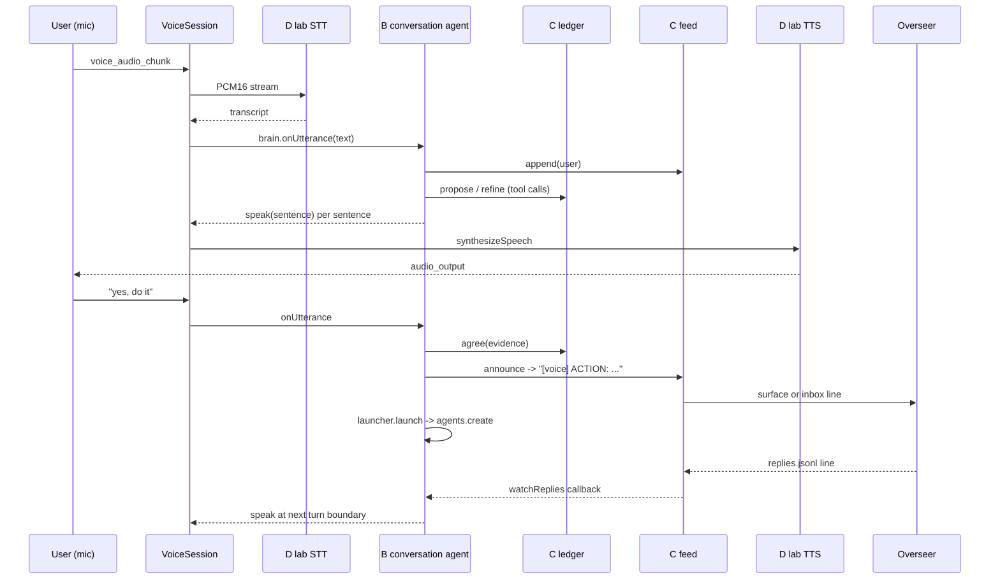

# Pyrgos Paseo: design note (MIC-750 A)

Voice conversation agent inside this fork of getpaseo/paseo. B, C and D start from this file.
Paths are relative to the repo root. "Core change" means an edit outside `packages/server/src/server/pyrgos/`
and `docs/pyrgos/`. Config comes from env vars; names only, never values.

## 1. Decision summary

| Piece | Where it lives | How it plugs in |
|---|---|---|
| B conversation agent | `packages/server/src/server/pyrgos/conversation-agent/` | One optional "voice brain" hook on `VoiceSession` (core change 2). Falls back to stock voice mode when unset. |
| C ledger + feed | `packages/server/src/server/pyrgos/ledger/` (pure), `packages/server/src/server/pyrgos/feed/` (I/O), UI in `plugins/pyrgos-ledger/` | Ledger is a pure module; B owns the instance; the UI is a normal plugin (`docs/plugins.md:565` file panels, `:530` sidebar items). |
| D lab speech | `packages/server/src/server/pyrgos/speech/` | New provider id `lab` in the closed enum (core change 1). |

Rule: B imports C and D only through the interfaces in section 4. C and D never import B.

## 2. Existing seams (verified in this checkout)

Voice turn today (stock):

1. Client streams PCM as `voice_audio_chunk`; `VoiceSession` (`packages/server/src/server/session/voice/voice-session.ts`)
   buffers, runs turn detection, calls the STT provider.
2. `handleTranscriptionResultPayload` (`voice-session.ts:964`) emits `transcription_result` and `activity_log`, then calls
   `host.sendSpokenInput(agentId, text)` (`voice-session.ts:~1049`). The host (`packages/server/src/server/session.ts:1250`) forwards to
   `handleSendAgentMessage(..., { spokenInput: true })`.
3. The bound Paseo agent answers by calling the `speak` MCP tool. `registerVoiceBridgeForAgent` (`voice-session.ts:~1061`)
   installs a `VoiceSpeakHandler` (`session/voice/voice-types.ts`) that calls `ttsManager.generateAndWaitForPlayback(text, emit, signal, true)`
   (`packages/server/src/server/agent/tts-manager.ts:150`), then emits `activity_log`.
4. Voice mode is enabled per socket by `set_voice_mode {enabled, agentId}` (`voice-session.ts:354`), which stores `voiceModeAgentId`
   and rewrites the agent prompt (`session/voice/voice-config.ts`, `buildVoiceModeSystemPrompt`).
5. `abort_request` -> `handleAbort` (`voice-session.ts:~1097`); `audio_played` -> `handleAudioPlayed` (`voice-session.ts:~1142`).

Wire events (names fixed by `packages/protocol/src/messages.ts`; listed in `docs/architecture.md:298`):
inbound `voice_audio_chunk`, `abort_request`, `audio_played`, `set_voice_mode`, `dictation_stream_*`;
outbound `audio_output`, `transcription_result`, `voice_input_state`, `set_voice_mode_response`, `activity_log`, `assistant_chunk`.
We add no wire events in v1 (see section 6).

Speech provider interfaces (`packages/server/src/server/speech/speech-provider.ts`):

```ts
interface SpeechToTextProvider { id: string; createSession(p: { logger; language?; prompt? }): StreamingTranscriptionSession } // PCM16LE in; committed/transcript/error out
interface TextToSpeechProvider { synthesizeSpeech(text: string): Promise<{ stream: Readable; format: string }> }
```

Resolution: `speech/speech-runtime.ts:50-60` defaults all four roles (`dictationStt`, `voiceTurnDetection`, `voiceStt`, `voiceTts`) to `local`;
`speech/speech-types.ts` declares `SpeechProviderIdSchema = z.enum(["openai", "local"])` (closed).

Plugin APIs (`packages/plugin/src/server/contracts.ts:30`): `PluginServerContext` offers `handle(contract, handler)` (RPC with
`context.paseo: PaseoApi`), `registerSettings`, `registerProvider` (agent providers, not speech), `registerUsageSource`, plus lifecycle
`server.on(...)` / `server.before(...)` (`packages/plugin/src/server/lifecycle.ts:48-75`: `agent.created`, `agent.turn_ended`,
`agent.closed`, `workspace.created`, before-hooks `agent.create`, `workspace.create`). Plugins cannot register speech providers or
voice hooks: that is why core changes 1 and 2 exist.

Agent launch: `PaseoApi.agents.create(options): Promise<PaseoAgentHandle>` (`packages/client/src/index.ts:391-406`), also the
`create_agent` tool (`packages/server/src/server/agent/tools/paseo-tools.ts:1586`) and `createAgentCommand`
(`packages/server/src/server/agent/create-agent/create.ts:156`).

## 3. Core changes (the whole list; each is small)

| # | File | Change | Why unavoidable |
|---|---|---|---|
| 1 | `packages/server/src/server/speech/speech-types.ts` | Add `"lab"` to `SpeechProviderIdSchema`. | The enum is closed; config parsing rejects unknown ids. |
| 1b | `packages/server/src/server/speech/speech-runtime.ts` | In the provider build step, when a role resolves to `lab`, call `createLabSpeech(config)` from `pyrgos/speech`. Default for `voiceTts` and `voiceStt` becomes `lab` only when `PYRGOS_LAB_TTS_URL` / `PYRGOS_LAB_STT_URL` is set; else stays `local` (stock fallback). | Providers are constructed in this one function; no registry exists. |
| 2 | `packages/server/src/server/session/voice/voice-session.ts` (+ `index.ts` options type) | Add optional `VoiceBrain` to `VoiceSessionOptions`. In `handleTranscriptionResultPayload`, if a brain is set, call `brain.onUtterance(text, ctx)` instead of requiring a bound agent and `host.sendSpokenInput`. Abort calls `brain.cancel()`. Wire `speak` through the existing `ttsManager` path so playback acks, abort and `activity_log` behave identically. | The seam today only forwards text to a Paseo agent whose reply costs a full agent turn and an MCP `speak` call; sub-2 s replies need a direct call. |
| 3 | `packages/server/src/server/session.ts` (near `:1250`) | Construct the brain from `pyrgos/conversation-agent` when `PYRGOS_VOICE=1` and pass it in the options. | Session assembly is the only place that knows the host callbacks. |
| 4 | `packages/server/src/server/bootstrap.ts` (or the file that builds `PluginServerContext`; B/C confirm the exact name) | Expose the ledger and feed to the ledger plugin through a handler context field, or run the plugin RPC against a module singleton. | Plugin handlers only receive `paseo`; they need ledger reads. Preferred: the ledger plugin's `index.server.ts` imports `pyrgos/ledger` through the plugin-local copy (no core change) and reads the same JSONL file. Only add this change if that proves racy. |

Everything else is additive under `pyrgos/`, `plugins/pyrgos-ledger/` and `docs/pyrgos/`. Upstream merge surface: three small edits
plus one optional.

`VoiceBrain` (defined in `pyrgos/conversation-agent/types.ts`, imported by `voice-session.ts` as a type only):

```ts
export interface VoiceBrainContext {
  speak(sentence: string, signal: AbortSignal): Promise<void>; // = ttsManager.generateAndWaitForPlayback(...), emits activity_log
  signal: AbortSignal;                                         // per-utterance: aborted by abort_request or a new user utterance
}
export interface VoiceBrainEvents {                            // push events; VoiceSession calls these, the brain never polls
  onUserSpeechStarted(): void;                                 // from callbacks.onSpeechStarted (voice-session.ts:~590), before STT finishes
  onUserSpeechEnded(): void;                                   // from the voice_input_state isSpeaking=false emit (:677)
  onPlaybackStarted(): void;                                   // first audio_output of a TTS request
  onPlaybackComplete(): void;                                  // last audio_played ack, or abort/cancel (handleAudioPlayed :1142, handleAbort :1097)
}
export interface VoiceBrain extends VoiceBrainEvents {
  onUtterance(text: string, ctx: VoiceBrainContext): Promise<void>; // resolves when the turn is spoken
  speakStanding(text: string): Promise<void>;                  // out-of-turn speech (overseer replies); VoiceSession mints a fresh signal
  cancel(): void;
  dispose(): void;
}
```

**Enabling voice mode without a bound agent (core change 2, in `handleSetVoiceMode`, `voice-session.ts:354`).** The wire message already
allows it: `SetVoiceModeMessageSchema.agentId` is optional and `set_voice_mode_response.agentId` is nullable
(`packages/protocol/src/messages.ts:1070-1075`, `:2173-2178`), so no protocol or client change is needed. When a brain is configured for the
session, `handleSetVoiceMode(true, agentId?)`:

1. skips `parseVoiceTargetAgentId` (`:367`), `enableVoiceModeForAgent` (`:491`, which rewrites the agent prompt) and
   `registerVoiceBridgeForAgent` (no `speak` MCP tool is registered, no `voiceModeAgentId` is set);
2. sets `isVoiceMode = true` with `voiceModeAgentId = null` and replies `accepted: true, agentId: null`;
3. ignores any `agentId` the client sends (`voice-runtime.ts:573,756` still pass the active agent): it is never bound, so the Paseo agent
   the user is looking at receives no spoken input and no voice system prompt. The branch in `handleTranscriptionResultPayload` goes
   before the `if (!agentId)` skip (`:~1040`) and returns after `brain.onUtterance`; `host.sendSpokenInput` is unreachable in brain mode.

`set_voice_mode(false)` disposes the brain's turn state (`cancel()`), not the brain. With no brain configured nothing changes (stock path).

## 4. Interfaces between B, C and D

### 4.1 C: ledger (pure, no I/O except the JSONL path passed in)

`packages/server/src/server/pyrgos/ledger/index.ts`:

```ts
export type ItemState = "draft" | "refined" | "agreed" | "dropped";
export interface ActionItem {
  id: string;            // ulid; stable
  text: string;          // one line, <= 400 chars
  state: ItemState;
  createdAt: string;     // ISO; injected clock
  updatedAt: string;
  transcriptRef: string; // "<session-file>#<line>" from the feed
  route: "paseo" | "dispatch"; // set at propose, immutable (section 4.4)
  ticketId?: string;
  launch?: { status: "launching" | "launched" | "failed"; agentId?: string; lane?: string; reason?: string } | null;
}
export interface Ledger {
  list(filter?: { state?: ItemState }): ActionItem[];
  propose(text: string, transcriptRef: string, opts?: { ticketId?: string; route?: "paseo" | "dispatch" }): ActionItem; // -> draft
  refine(id: string, text: string): ActionItem;                             // draft|refined -> refined
  agree(id: string, evidence: { transcriptRef: string; phrase: string }): ActionItem; // refined -> agreed
  drop(id: string): ActionItem;                                             // any non-agreed -> dropped
  beginLaunch(id: string, route: "paseo" | "dispatch"): ActionItem;        // agreed only; throws if launching/launched (the lock)
  markLaunched(id: string, launch: { agentId: string; lane: string }): ActionItem;
  failLaunch(id: string, reason: string): ActionItem;
  clearLaunch(id: string): ActionItem;                                      // after a spoken "retry"
  subscribe(fn: (items: ActionItem[]) => void): () => void;
}
export function createLedger(opts: { path: string; clock?: () => Date; id?: () => string }): Ledger;
```

Rules: transitions are exactly draft->refined->agreed, with drop from draft/refined; anything else throws `LedgerTransitionError`.
`agree` throws unless `evidence.phrase` normalizes to one of the agreement phrases ("yes, do it", "yes do it"); the caller (B) passes
the user's actual transcript line, so agreement cannot come from the model alone. Persistence: append-only JSONL, one event per line
(`{ts, op, id, ...}`), replayed on `createLedger`. Changes since the contract in the MIC-750 brief: `agree` takes `evidence`, `route`/`ticketId`/`beginLaunch`/`failLaunch`/`clearLaunch` are added, and
`markLaunched` plus `subscribe` are added. These are additive.

### 4.2 B: conversation agent

`packages/server/src/server/pyrgos/conversation-agent/index.ts`:

```ts
export function createConversationAgent(deps: {
  ledger: Ledger;
  feed: Feed;                 // 4.3
  launcher: AgentLauncher;    // 4.4
  llm: ChatBrain;             // Claude via subscription, see below
  logger: Logger;
}): VoiceBrain;
```

- `ChatBrain.stream(messages, tools, signal): AsyncIterable<{ type: "text"; delta: string } | { type: "tool_call"; name; args }>`.
  Implementation uses the Claude Agent SDK / Claude Code login that Paseo's Claude provider already uses
  (`packages/server/src/server/agent/providers/claude/`; B reads the Claude adapter there and reuses its auth path). No API key, no metered call.
- Sentence chunker (port of `voice_agent/chunker.py` in the voice-agent repo): flush each completed sentence to `ctx.speak` while the
  stream continues. First audio target: under 2 s from end of user speech.
- Context (port of `voice_agent/context.py`): harness summary text built once at start and refreshed on a timer, redacted of secrets.
  Source path from env `PYRGOS_CONTEXT_FILE`; absent means no context.
- Tools exposed to the model (names fixed so prompts and tests agree): `propose_item(text)`, `refine_item(id, text)`,
  `drop_item(id)`, `list_items()`, `request_agreement(id)`. There is **no** `agree` or `launch` tool: B itself calls `ledger.agree` only when
  the last user utterance matches the agreement phrase and an item is in `refined` and was read back in the previous assistant turn.
  After `agree`, B calls `feed.announce` then `launcher.launch`; the model is told afterwards.
- Hard rules in the system prompt and in code: never push, merge, delete or spend; only record, announce and launch through the lanes.

### 4.3 C: overseer feed (`packages/server/src/server/pyrgos/feed/`)

```ts
export interface Feed {
  append(speaker: "user" | "assistant" | "overseer" | "system" | "action", text: string): { line: number; ref: string };
  announce(item: ActionItem): { ok: boolean; via: "surface" | "inbox"; line: string };
  watchReplies(onReply: (reply: { ts: string; text: string }) => void): () => void;
}
export function createFeed(opts: { dir: string; sessionId: string; clock?; exec?; home? }): Feed;
```

Direct ports of `voice_agent/feed.py` (pyrgos-voice-agent repo), same formats so the overseer's existing tooling keeps working:

- Transcript: `<dir>/<sessionId>.jsonl`, one `{ts, speaker, text}` per line, appended under a file lock so `line` is the 1-based number of
  the line just written. B appends every user utterance and assistant sentence.
- Announce line, one line, max 400 chars, truncated with an ellipsis:
  `[voice] ACTION: <item> (transcript: <path>#<line>)`.
  Delivery: if env `PYRGOS_OVERSEER_SURFACE` is set, run the configured send command for that surface; otherwise append the line to the
  lab-side inbox file (`pc-inbox.md` in the home directory, name overridable by `PYRGOS_INBOX_FILE`). Env names only; values stay local.
- Replies: the overseer appends `{ts, text}` lines to `<dir>/<sessionId>.replies.jsonl`. `watchReplies` tails it (poll about 1 s,
  each line delivered once).
- Dir: env `PYRGOS_FEED_DIR`; default a `pyrgos-feed` folder under the OS state dir.

### 4.4 Agent launcher (B uses, C owns the wiring to dispatch)

```ts
export interface AgentLauncher {
  launch(item: ActionItem): Promise<{ agentId: string; lane: string }>;
}
```

**Exactly one route owns each item.** `ActionItem` gains `route: "paseo" | "dispatch"`, fixed when the item is proposed and never
changed after `agreed`: `dispatch` only when the user named a ticket (`ticketId` set) **and** `PYRGOS_DISPATCH_CMD` is configured,
otherwise `paseo`. The launcher never runs both.

- **`paseo` route:** `PaseoApi.agents.create({ ... })` (`packages/client/src/index.ts:400`) with `initialPrompt` = item text + transcript
  ref, in the workspace named by `PYRGOS_LAUNCH_WORKSPACE` (or the project the user named). `PaseoApi` is reached as plugin handlers reach it
  (`PluginHandlerContext.paseo`, `packages/plugin/src/server/contracts.ts:11`); a loopback `createPaseoClient` is acceptable.
- **`dispatch` route:** a fixed argv, never model-built text: `$PYRGOS_DISPATCH_CMD <kind> "<spec>" --ticket <ticketId>` (`.sh`, or the
  `.ps1` twin on Windows). The dispatcher creates its own worktree and agent; Paseo creates nothing. The voice session only observes it
  (the dispatched agent appears in Paseo's agent list like any other, via `agent.created`, `packages/plugin/src/server/lifecycle.ts:66`).
- **Duplicate prevention:** the ledger is the lock. `launch` first calls `ledger.beginLaunch(id, route)`, an append-only event that throws
  `LedgerTransitionError` if the item already has a `launching` or `launched` marker, so a second call (retry, double "yes, do it", restart
  replay) stops before doing any work. The item id is passed as the idempotency key: `agents.create` gets label `pyrgos-item:<id>`, and the
  dispatch spec carries `item:<id>`; before `beginLaunch` the launcher lists agents/the dispatcher's open runs for that key and adopts a match
  instead of launching. Then `markLaunched(id, {agentId, lane})` or `failLaunch(id, reason)`. A crash between begin and mark leaves
  `launching`; B tells the user and re-launches only after a spoken "retry" (`ledger.clearLaunch`), never automatically.
- Then `feed.append("system", ...)` and the assistant says so aloud.

Guardrail: `launch` refuses any item whose state is not `agreed` or whose agreement evidence is missing.

### 4.5 D: lab speech providers

`packages/server/src/server/pyrgos/speech/index.ts`:

```ts
export function createLabSpeech(cfg: LabSpeechConfig): { tts?: TextToSpeechProvider; stt?: SpeechToTextProvider };
export interface LabSpeechConfig { ttsUrl?: string; sttUrl?: string; voice: string }
```

Each role is independent: `tts` is built only when `ttsUrl` is set, `stt` only when `sttUrl` is set, and the other is `undefined`.
A TTS-only or STT-only lab config is valid. `speech-runtime.ts` (core change 1b) resolves each role on its own: a role with a lab
provider uses `lab`, a role without one keeps the stock `local` provider. Setting neither URL builds nothing.

- Config env: `PYRGOS_LAB_TTS_URL`, `PYRGOS_LAB_STT_URL` (websocket URLs), `PYRGOS_LAB_VOICE`
  (default `profile:winner-r6-s49-heart-alice-bella`, the locked preset; mirrors `LOCAL_REPLY_VOICE` in
  `voice_agent/services.py` of the voice-agent repo).
- TTS: websocket client for the lab server (`lab/tts_server.py`, Kokoro). Client sends `{"type":"speak","text","voice"}`; server streams
  audio frames. Provider returns `{ stream, format }` matching what `tts-manager.ts` expects (check the format string used by the stock
  local provider and match it; resample inside D if the lab emits a different rate).
- STT: websocket client for the lab server (`lab/stt_server.py`, faster-whisper small.en). Implements `StreamingTranscriptionSession`
  (PCM16LE in; committed/transcript/error out) per `speech-provider.ts`.
- Fallback: if the websocket does not connect within a short timeout, or drops mid-turn, the provider throws a typed
  `LabUnavailableError` and `speech-runtime.ts` (core change 1b) falls back to the stock `local` provider for that turn. A health probe
  at startup logs which one is active.
- Tests: fake websocket servers in-process; no network, no GPU.

## 5. Turn flow, including a spoken overseer reply



Turn-boundary reply (port of `TurnGate`/`pump_replies`, `voice_agent/feed.py`): B keeps a gate with flags `user`, `bot` and `llm`,
driven only by the `VoiceBrainEvents` push calls in section 3: `user` = true on `onUserSpeechStarted`, false on `onUserSpeechEnded`;
`bot` = true on `onPlaybackStarted`, false on `onPlaybackComplete` (which VoiceSession also fires on abort, so an interrupted reply
cannot leave `bot` stuck); `llm` = a `ChatBrain.stream` is open. A queued overseer reply is spoken only when all three are false, as
`The overseer says: <text>`, via `brain.speakStanding(text)`. B never reuses a stored `VoiceBrainContext`: its `signal` belongs to one
utterance and is already aborted after any interruption. `speakStanding` makes VoiceSession mint a fresh `AbortController` linked to the
session's own (`this.abortController`, as `registerVoiceBridgeForAgent` does at `:~1066`), and it is cancelled by the next
`onUserSpeechStarted`. B appends the `overseer` transcript line after queuing and re-checks the gate before each further reply. Reply
delivery uses a persisted cursor, not memory. C stores `{offset, lastSeq}` in a small file beside the replies file
(`replies.cursor.json`, written atomically via temp file plus rename). `watchReplies` reads from the saved offset, so a restart neither
repeats nor loses a reply. A reply is *read* when it is appended to a durable `replies.pending.jsonl` (the cursor advances only after
that append), and *acked* when `speakStanding` resolves for it (the line is then removed from pending). On startup B reloads
`replies.pending.jsonl` into the queue before tailing from the cursor. Replies that arrive while voice mode is off (`isVoiceMode`
false) are read and parked in pending, then spoken at the next turn boundary after voice mode turns on. If the replies file shrinks
(rotated or truncated) the offset resets to 0 and already-acked sequence numbers are skipped using `lastSeq`.

## 6. Client / UI

- Voice client code is untouched: `packages/app/src/voice/voice-runtime.ts` already handles streaming, `audio_output` and aborts on
  desktop (Electron `packages/desktop`) and Expo Android, so C/B work on all three targets without client edits.
- Ledger panel: plugin `plugins/pyrgos-ledger/` (`index.client.tsx`, `index.server.ts`, `shared/` zod contracts, `paseo-plugin.json`
  as in `plugin-examples/markdown-panel/`). RPC contracts: `ledger.list`, `ledger.subscribe`-style polling via `handle()` (no new wire
  events), `ledger.drop(id)`. The panel never calls `agree`; agreement is voice-only. Buttons: use `docs/plugins.md:585` pattern.
- Lab reaches the Android app through the existing relay/Tailscale path; D adds no inbound ports.

## 7. Tests and layout

- B, C, D are each unit-tested with the repo's runner (`docs/development.md`; B/C/D confirm the command), tests first, with injected
  clock, fake LLM stream, fake websockets and a temp dir for JSONL.
- Contract tests live in `packages/server/src/server/pyrgos/__tests__/contracts.test.ts` (A adds none; B owns this file and the type
  imports in section 4 are copied verbatim into `pyrgos/types.ts` by whichever of B/C lands first).
- Docs: each piece appends to `docs/pyrgos/HOW-IT-WAS-BUILT.md` and `docs/pyrgos/skill-log.md`.

## 8. Open questions (assumed until settled)

1. Core change 4 (ledger visibility to the plugin): assumed unnecessary because both sides read the same JSONL. Settle by C building
   the panel first.
2. Direct brain vs bound Paseo agent: assumed direct (core change 2) because the stock path adds an agent turn and an MCP call to every
   reply. Settle by B measuring time-to-first-audio on both; if the stock path is under 2 s, drop core change 2.
3. Exact audio format of `TextToSpeechProvider.synthesizeSpeech` results: D reads the stock local provider and matches it.
4. Which Claude path in `agent/providers/` gives streaming text without a full agent loop: B decides after reading the adapter.
