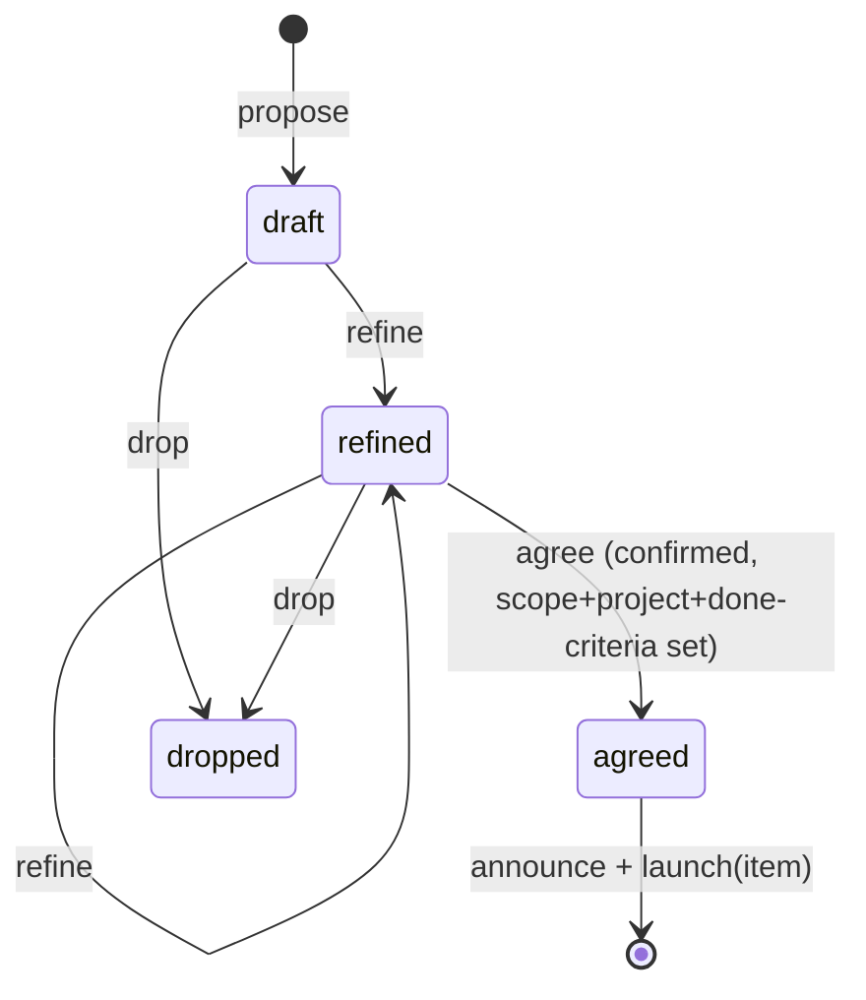

# Action-item ledger

The voice brain records what Michael asks for as action items. An item moves `draft` → `refined` → `agreed`, or to `dropped`. Only an explicit confirm moves it to `agreed`, and agreeing launches an agent.

## Code

- `packages/server/src/server/pyrgos/ledger/ledger.ts`: `createLedger({ store, now?, newId?, announce?, launch? })` with `propose`, `refine`, `agree`, `drop`, `get`, `list`. Pure state machine; no I/O of its own.
- `jsonl-store.ts`: JSONL persistence. Each change appends the full item to `<session>.ledger.jsonl`; on load the last row per id wins.
- `feed.ts`: port of the Python `voice_agent/feed.py` (MIC-749).
  - `createVoiceSession`: transcript `<session>.jsonl`, one `{ts, speaker, text}` row per line. `append` returns the 1-based line number; a lock file plus an in-process queue make count and write atomic.
  - `announceLine` / `createAnnouncer`: `[voice] ACTION: <item> (transcript: <path>#<line>)`, at most 400 characters. Sent with `wmux send $VOICE_OVERSEER_SURFACE <line>`; with no surface set it is appended to `~/pc-inbox.md`.
  - `ReplyWatcher`: tails `<session>.replies.jsonl`, returns each complete line once.
  - `TurnGate`: `user`/`bot`/`llm` busy flags plus `hold(seconds)` (default 20).
  - `ReplyPump`: speaks `The overseer says: <reply>` when the gate is idle, otherwise keeps the reply queued.

## Rules the ledger enforces

- `agree` needs state `refined` and non-empty scope, project and done-criteria; otherwise it throws `LedgerError` (`bad_state` or `incomplete`) and nothing is announced or launched.
- `agree` takes `{ confirmed: true }`. The brain calls it only after Michael says "yes, do it".
- On agree the item is saved, announced, then `launch(item)` runs. A launch failure is stored on the item (`launchError`); the item stays `agreed`.
- `agreed` and `dropped` items are frozen.
- The ledger never pushes, merges, deletes or spends. `launch` is injected; the design note wires it to Paseo agent launch and the dispatch lanes.

## Panel

`plugin-examples/pyrgos-action-ledger/` is a Paseo workspace panel plugin ("Action items") that polls an RPC every 2 seconds and lists the items grouped by state. The server side reads the newest `*.ledger.jsonl` in the voice directory. The plugin cannot import host server code, so it carries its own copy of the item schema in `shared/ledger-view.ts`.

## Environment

| Name                     | Use                                                                                                                   |
| ------------------------ | --------------------------------------------------------------------------------------------------------------------- |
| `ALCHEMIST_HARNESS`      | Root of the harness; the voice directory is `$ALCHEMIST_HARNESS/.agents/feedback/voice` (a temp directory when unset) |
| `VOICE_OVERSEER_SURFACE` | wmux surface that receives the announce line                                                                          |
| `PYRGOS_LEDGER_FILE`     | Optional: pin the panel to one ledger file                                                                            |

## Tests

- `npx vitest run src/server/pyrgos/ledger` in `packages/server`.
- `npx vitest run` in `plugin-examples/pyrgos-action-ledger` (renders the list from `fixtures/session.ledger.jsonl`).
