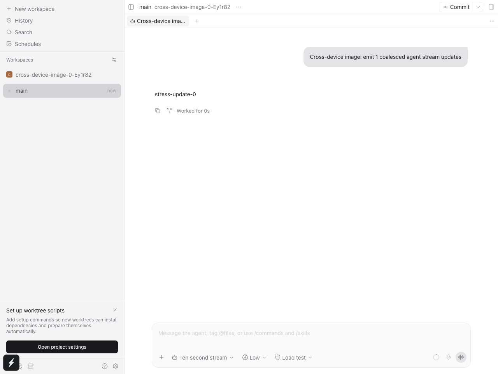
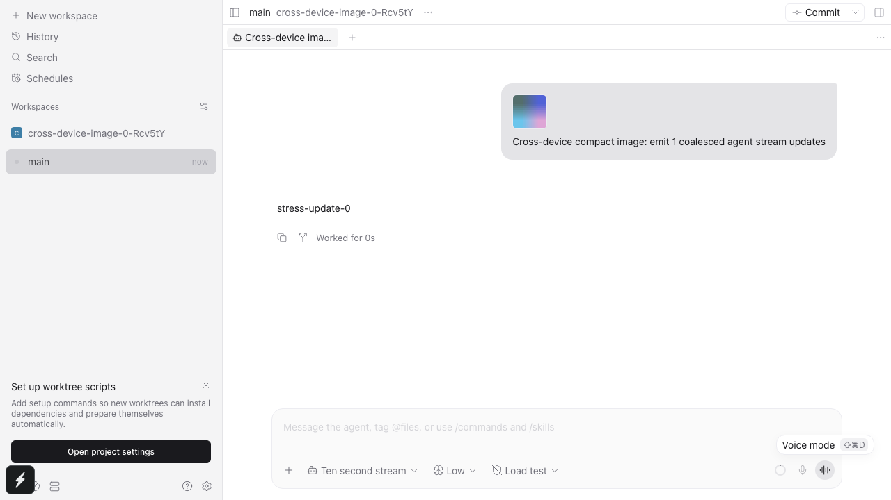
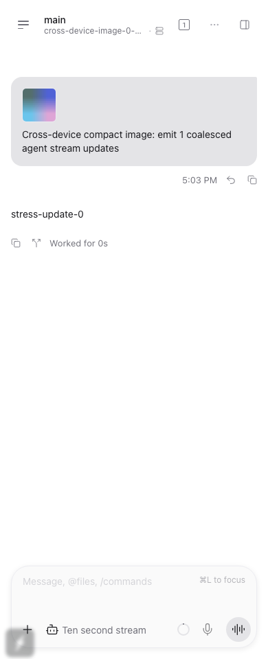

# Cross-device user image history

Images sent from one Paseo client must remain visible on another client and after reload. The model already receives the image; the missing data is in the shared user-message history.

## Reproduction before the patch

The browser regressions use the real app, an isolated daemon, and independent browser contexts. The receiver copies host and onboarding settings before submission, so it has neither the sender's optimistic message nor its local image cache. The test submits a valid PNG through the composer and checks the decoded thumbnail dimensions, not just the existence of a placeholder.

```sh
npm run test:e2e --workspace=@getpaseo/app -- \
  e2e/browser/agent-message-submission.spec.ts \
  --grep 'cross-device image' --workers=1 --retries=0
```

Selected failure output from the original two cases, with ANSI color removed:

```text
cross-device image loads on sender, receiver, and receiver reload (text and image)
Locator: getByTestId('user-message').getByRole('button', { name: 'Open image attachment' })
Expected: 1
Received: 0

cross-device image loads on sender, receiver, and receiver reload (image-only)
Locator: getByTestId('user-message')
Expected: 1
Received: 0

2 failed
```

The sender's thumbnail decoded successfully before each receiver assertion failed.



## Browser verification after the patch

The same command passes. The regression now also includes a compact receiver and captures sender and receiver screenshots. Each receiver reloads and must decode the image again from shared history.

```text
3 passed
```

The compact case also passed with the HTML reporter enabled to retain its screenshot attachments.





## Real Pi verification

A separate temporary probe used a real isolated Paseo daemon, two independent SDK clients, and the real Pi provider. It ran once with `claude-code-proxy/gpt-6.1-terra` and once with `claude-code-proxy/claude-haiku-5-5`.

1. Generate a PNG containing six random digits that do not occur in the prompt, title, or filename.
2. Send the bytes through the normal SDK image submission and require the model to transcribe the digits.
3. Fetch canonical history through both clients. Require matching stored image references and no inline image bytes.
4. Read the image through `readTimelineImage` on both clients. Require the returned byte hash to match the submitted PNG.
5. Close both clients and restart only the isolated daemon with the same temporary home. Reconnect fresh clients and repeat the history and byte assertions without resending the image.

Both runs printed:

```text
PASS: real Pi image recognition, two clients, exact image RPC bytes, and daemon restart
```

The production daemon and existing conversations were not restarted or modified.

## Focused automated checks

Focused runs selected these files with `npx vitest run <files> --bail=1` in their workspaces. Final successful result counts:

| Workspace | Test file                                                             | Tests passed |
| --------- | --------------------------------------------------------------------- | -----------: |
| server    | `src/server/agent/providers/provider-image-output.test.ts`            |           19 |
| server    | `src/server/agent/agent-manager.test.ts`                              |          253 |
| server    | `src/server/agent/conversation-images.test.ts`                        |            5 |
| server    | `src/server/agent/agent-timeline-content.test.ts`                     |           11 |
| server    | `src/server/agent/providers/claude/agent.import-large-record.test.ts` |            8 |
| server    | `src/server/agent/providers/pi/history-mapper.test.ts`                |           18 |
| server    | `src/server/agent/providers/omp/history-mapper.test.ts`               |           21 |
| server    | `src/server/agent/providers/claude/agent.test.ts`                     |          121 |
| server    | `src/server/agent/providers/codex-app-server-agent.test.ts`           |          215 |
| server    | `src/server/agent/providers/acp-agent.test.ts`                        |          127 |
| server    | `src/server/agent/providers/opencode-agent.test.ts`                   |          143 |
| server    | `src/server/agent/providers/opencode/v2/timeline.test.ts`             |            6 |
| server    | `src/server/authorization/index.test.ts`                              |           11 |
| server    | `src/server/websocket-server.file-transfer.e2e.test.ts`               |            4 |
| app       | `src/types/stream.test.ts`                                            |           71 |
| app       | `src/runtime/replica-cache/index.test.ts`                             |           52 |
| app       | `src/components/message-images.browser.test.tsx`                      |            6 |
| protocol  | `src/messages.attachments.test.ts`                                    |           13 |

These are 1,104 tests across 18 files, not a full-suite run. They cover native replay, duplicate and image-only messages, reopened storage, missing temporary inputs, membership checks, permissions, binary transfer, protocol parsing, and replica-cache round trips.

Independent review exposed two additional paths. Three manager regressions first failed on raw `imageSources` escaping imported parent, imported child, and already-primed initial history. After normalization was moved before projection and content limiting on those paths, the manager file passed all 253 tests. A separate Chromium regression first failed because child images used a synthetic display-stream ID for the image RPC. Both browser component tests now pass, checking the parent-agent RPC arguments, a decoded thumbnail, unchanged message-action identity, and the default owner for ordinary messages. This component regression does not mount the full provider-child panel.

Further review regressions cover virtualized remounts without another image RPC, refetch after local-byte deletion, and recovery when attachment GC has already taken its snapshot. The binding-store tests check bounded per-message writes, atomic alias groups, restart recovery, failed-write retries, private permissions, legacy manifests, and numeric replay ordering. Binding records avoid rewriting every earlier message on each import; they are not compacted automatically.

A further red-first regression follows real Claude native transcript replay through its history converter and image capture with 1 MiB of base64-encoded bytes and no prior binding. It now recovers the exact bytes while keeping normalized public rows source-free and within the text budget. Limiter regressions also verify that nested tool data and ordinary text remain bounded.

Claude now captures immutable bytes before any history accumulator retains a converted row. A structural regression checks 18 images across parent, child, and workflow histories before streaming, including materialized imports, exact reopened bytes, and reload. Additional cases check builtin/inherited-provider capture wiring, explicit missing-capability errors, capture-failure continuation and prior-binding recovery, and imageless compatibility. Cached histories retain references rather than aggregate base64.

The three browser regressions and the real Pi/Haiku restart probe passed again after the cache and binding-record changes. The following commands also passed on the final source after workspace declarations were rebuilt:

```sh
npm run build:server
npm run typecheck
npm run lint
npm run format:check
git diff --check
```

## Scope and remaining gaps

Web was verified on macOS at desktop and compact widths. Native iOS, Android, packaged Electron, Windows, and Linux were not exercised.

Legacy OMP blob-only images without a saved image binding are shown as unavailable. The daemon does not fetch remote URLs or arbitrary transcript file paths. Lost image bytes cannot be reconstructed. Image garbage collection and restoring image attachments into a rewound composer draft remain outside this patch.
