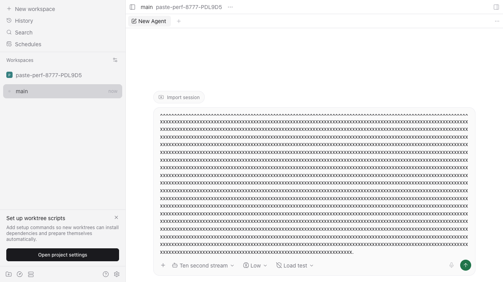
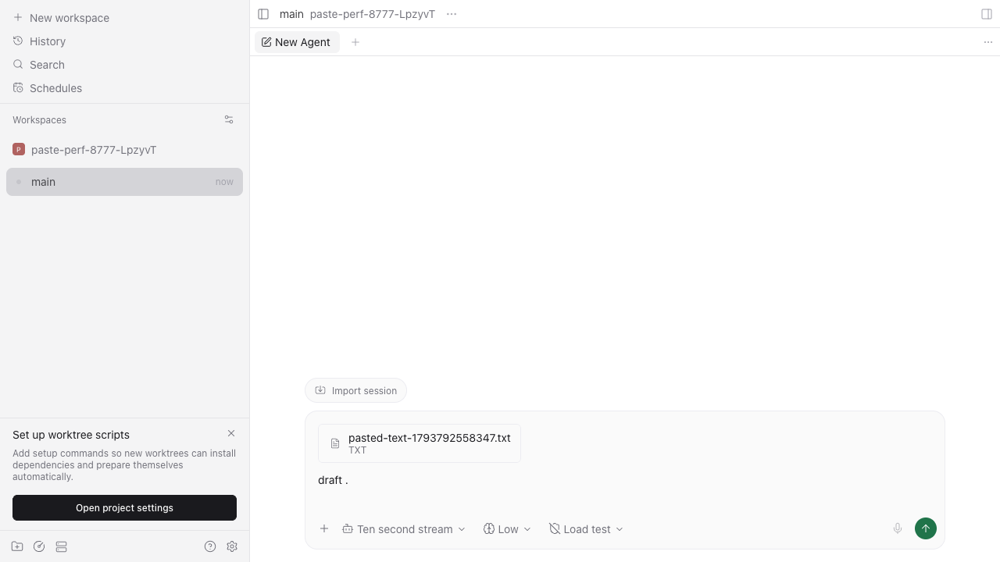

# Large clipboard paste: Mac Studio comparison

Measured 2026-11-04 on `rrd-mac-studio`: Apple M5 Max, 18 cores, 64 GB, macOS 27.0.1 (26A434), Node 24.22.1, Google Chrome 156.0.8078.80. The machine was shared with existing workloads; those processes were left running. No CPU throttling was configured.

This is the real app in a **headed browser window**, with a fresh browser context, real clipboard, real isolated daemon, and a 1280 × 720 viewport. Every completed sample reported `document.visibilityState === "visible"`. Metro serves a development bundle. These numbers do not establish packaged Electron or native mobile performance.

## Source and method

The before run restores `packages/app/src/composer/input/input.tsx` and `packages/app/src/composer/index.tsx` from `4407283a134502bf4a7704bfa823fcfed7f702b0`, the pre-fix baseline. A `git diff --quiet` check against that revision returned 0 for both files. These are the browser production files changed by the original patch; the new clipboard helper is unused in the baseline. The after run uses the final production sources, recorded in [fixed-source.sha256](fixed-source.sha256).

[measurement.spec.ts.txt](measurement.spec.ts.txt) contains the exact final harness. Copy it into `packages/app/e2e/browser/paste-measurement.spec.ts` in an isolated checkout, and temporarily add `channel: "chrome", headless: false` to the existing browser Playwright project's `use` configuration. Both variants use the same installed Chrome and harness. Run sequentially:

```sh
PASTE_VARIANT=baseline E2E_RECORD_VIDEO=1 npm run test:e2e --workspace=@getpaseo/app -- e2e/browser/paste-measurement.spec.ts --max-failures=1
# The initial 60-second budget expired after both 2M single-line interactions returned.
# With the published harness's 120-second budget, complete the 2M cases:
PASTE_VARIANT=baseline E2E_RECORD_VIDEO=1 npm run test:e2e --workspace=@getpaseo/app -- e2e/browser/paste-measurement.spec.ts --grep 2000000 --max-failures=1
# Restore the final production sources before the comparison:
PASTE_VARIANT=fixed E2E_RECORD_VIDEO=1 npm run test:e2e --workspace=@getpaseo/app -- e2e/browser/paste-measurement.spec.ts --max-failures=1
```

The input starts with `draft `. The clipboard is either one uninterrupted line of `x`, or lines of 79 `x` followed by a newline, at 50K, 500K and 2M UTF-16 units. Each size/shape has three completed samples. The harness pastes with the real keyboard shortcut, then inserts `.` as a follow-up interaction.

- `paintedMs`: paste capture listener → second `requestAnimationFrame` callback. This is a frame scheduling measurement, not a compositor paint timestamp or upload completion time.
- `followupKeyAndPaintMs`: Node-side key insertion → second rAF, including automation overhead.
- `maxGapMs`: largest gap in a 10 ms main-thread timer over paste, follow-up input and the following 500 ms.
- `longTasks`: supplementary observer samples. Its start-time filter can omit a task that already started when paste fired; use the timer gap for the complete responsiveness comparison.

## Results

Medians of three completed samples, in milliseconds:

| UTF-16 units | Shape     | Before event → 2nd rAF (ms) | After (ms) | Before follow-up key → 2nd rAF (ms) | After (ms) | Before max timer gap (ms) | After (ms) |
| -----------: | --------- | --------------------------: | ---------: | ----------------------------------: | ---------: | ------------------------: | ---------: |
|       50,000 | single    |                       525.2 |       24.2 |                               547.4 |       33.8 |                     527.5 |       14.1 |
|       50,000 | multiline |                        18.4 |       25.9 |                                26.7 |       36.3 |                      19.7 |       17.3 |
|      500,000 | single    |                      6169.2 |       19.1 |                              6207.9 |       39.1 |                    6184.2 |       20.1 |
|      500,000 | multiline |                       153.0 |       27.6 |                               259.3 |       28.2 |                     238.3 |       15.1 |
|    2,000,000 | single    |                     28212.9 |       13.9 |                             28209.1 |       20.5 |                   28230.7 |       15.0 |
|    2,000,000 | multiline |                      1405.5 |       16.8 |                              3383.8 |       22.3 |                    3333.7 |       17.6 |

The baseline reproducibly stalls the main thread for seconds on large single lines, and also stalls on 2M multiline input. All observed interactions eventually returned; a permanent hang was not reproduced. The small 50K multiline case was already responsive and has a small attachment-path overhead after the change.

Before, every completed sample leaves `size + 7` UTF-16 units in the editor and zero file pills. After, all 18 samples leave exactly `draft .` (7 units) and one uploaded file pill; the file pill is checked after the measurement window. Exact UTF-8 upload contents, failure/retry, selection, mixed image/text, queue, reload and send are separately covered by the attachment E2E tests.

Raw data: [baseline.jsonl](baseline.jsonl), [fixed.jsonl](fixed.jsonl). The baseline file also preserves the initial 60-second test-budget failure: both interactions returned at about 28 seconds each, then `page.waitForTimeout(500)` hit the overall test deadline. This is a harness timeout, not a 60-second application hang. Completed 2M reruns used a 120-second budget; the other 12 baseline samples used the initial budget. The fixed run completed all 18 cases in 1.8 minutes.

Setup attempts before measurement encountered missing Playwright FFmpeg, a harness `performance` import serialization error, and project-list hydration timing. They produced no responsiveness samples. FFmpeg was installed, browser callbacks use global `performance`, and the harness opens the app shell before creating the temporary project. The earlier input-only pilot is excluded from the table and raw comparison data.

Before/after at 2M single-line input:




Recordings: [before](before-single.webm), [after](after-single.webm). Multiline screenshots: [before](before-multiline.png), [after](after-multiline.png).

[validation.txt](validation.txt) preserves targeted test and build output, including the dictation regression's failing/passing runs. [codex-reference.txt](codex-reference.txt) records the inspected installed Codex app version and plain-text threshold predicate. Web, iOS and Android use `>= 5000` UTF-16 units; rich-text/markdown conversion is outside this change.
