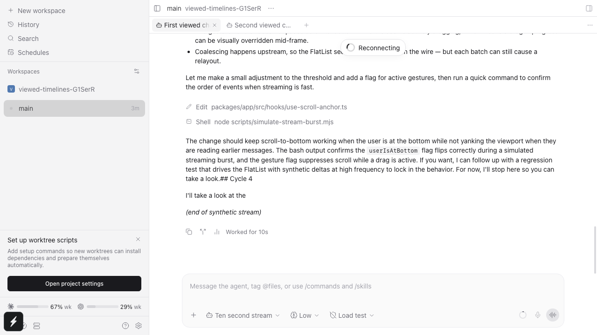

# Online client replacement: timeline recovery

Verified on macOS arm64 with Node 22.20.0, Chromium 145 (Playwright), and the real isolated test daemon. The daemon uses the deterministic test provider for replies; no external AI API is involved.

## Reproduction

1. Open two chats on one host and return to the first.
2. Delay the active connection's real pong frames by 250 ms, forwarding all real traffic.
3. Wait for an active liveness RTT sample, then add another direct endpoint for the same daemon.
4. Let the ordinary adaptive selector choose the faster endpoint after its required probe wins.
5. Confirm the host is still online, its client generation advanced, and the active endpoint changed.
6. Require the Reconnecting alert to disappear, then verify new messages arrive in both chats.

The test uses localhost and 127.0.0.1 as two paths to the same isolated daemon. It does not force host connection state or replace a private client field.

## Before

The test reached the online replacement but the Reconnecting alert remained visible for more than 30 seconds:

```text
Error: expect(locator).toHaveCount(expected) failed
Locator: getByRole('alert').filter({ hasText: 'Reconnecting' })
Expected: 0
Received: 1
Timeout: 30000ms
1 failed
```



## After

The final test source passes the replacement case and the existing ordinary reconnect case:

```sh
npm run test:e2e --workspace=@getpaseo/app -- \
  e2e/browser/viewed-agent-timelines.spec.ts \
  --grep 'online connection replacement|visible chat reports updating until reconnect' \
  --workers=1
```

```text
✓ an online connection replacement keeps every open chat synchronized (4.8m)
✓ a visible chat reports updating until reconnect catch-up completes (36.1s)
2 passed (5.6m)
```


## Other checks

```sh
npm run typecheck --workspace=@getpaseo/app
npm run lint -- packages/app/src/contexts/session-context.tsx packages/app/e2e/browser/viewed-agent-timelines.spec.ts
```

Typecheck exited 0. Lint reported `Found 0 warnings and 0 errors.`

Both unmodified and fixed renderers were exported with `PASEO_WEB_PLATFORM=electron npm exec -- expo export --platform web`. Server dependencies and desktop main were built through the repository npm scripts. Both were packaged locally using `electron-builder --config electron-builder.yml --publish never --mac --arm64 --dir -c.mac.notarize=false`, with certificate discovery disabled.

The existing `packages/desktop/e2e/packaged-app-smoke.js --app <built-app>` passed for both packages, using fresh temporary user data/daemon homes and loopback ports:

```text
Packaged desktop smoke: real app renderer and preload bridge loaded
Packaged desktop smoke: renderer-started desktop daemon reported running
Packaged desktop smoke: every built-in plugin started
Packaged desktop smoke: running bundled CLI shim daemon status
Packaged desktop smoke: creating terminal through bundled CLI shim
Packaged desktop smoke: terminal hook command completed
Packaged desktop smoke passed: real renderer and preload loaded; renderer-started desktop daemon;
CLI shim daemon status and terminal smoke succeeded
```

The final smoke summary above omits ephemeral PID/listen values. The reconnect regression runs in Chromium, not inside the packaged Electron renderer. The native smoke establishes packaged startup and terminal functionality, not native reconnect coverage.

## Coverage limits

- Web: real browser/daemon regression before and after.
- macOS desktop: local arm64 packaging and native startup/CLI/terminal smoke.
- iOS, Android, Windows desktop, Linux desktop: not tested.
- External relay transport and a real provider turn: not tested by this regression.
- No full-suite or CI pass is claimed by these local results.
