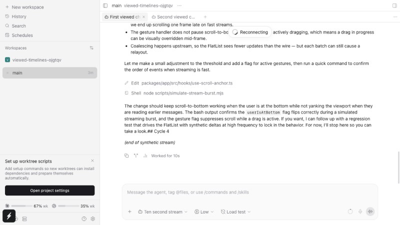
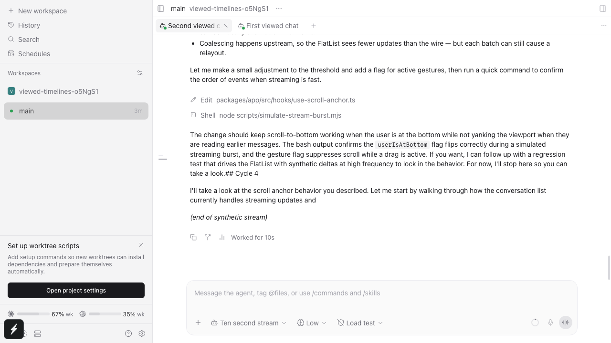

# Online client replacement: timeline recovery

Verified on macOS arm64 with Node 22.20.0, Chromium 145 (Playwright), and a real isolated daemon. Replies use the deterministic test provider; no external AI API is involved.

## Reproduction

1. Open two chats on one host and return to the first.
2. Delay the active connection's real pong frames by 1 second, forwarding all real traffic, and wait for a measured liveness RTT.
3. Add another direct endpoint for the same daemon.
4. Advance the browser clock in 10-second steps. Each step waits for real delayed heartbeat replies and the public probe-cycle completion barrier, including replacement handshakes. The production selector and its timer constants are unchanged.
5. Verify that every observed host snapshot stays online with a client, then confirm exactly one client-generation change to the faster endpoint.
6. Require the Reconnecting alert to disappear within 3 seconds and verify a new message in the visible chat.
7. Commit a message to the hidden second chat before reopening it. Verify that message is recovered, then verify another live message.

The two paths are localhost and 127.0.0.1 to the same daemon. The test does not force host state or replace a private client field. It controls browser time, not the daemon clock or real socket responses. Subscription assertions require the needed agents without requiring all other agents to be absent; exact matching remains the shared helper's default. The test has a 180-second timeout and a bounded clock-step budget allowing one candidate backoff. Observers, handles, timers, and scenario data are cleaned up even on failure.

## Before: exact final test source

Temporarily remove only the production `sync.setConnected(...)` seed, run the final regression, and restore the source in a `finally` block. The host remains online and changes to generation 2, but Reconnecting does not settle:

```text
Error: expect(locator).toHaveCount(expected) failed
Locator: getByRole('alert').filter({ hasText: 'Reconnecting' })
Expected: 0
Received: 1
Timeout: 3000ms
1 failed
```

The frame below is extracted without modification from that final RED trace while the assertion was waiting, before fixture cleanup.



## After

Restore the production seed without changing the test files, then run:

```sh
npm run test:e2e --workspace=@getpaseo/app -- \
  e2e/browser/viewed-agent-timelines.spec.ts \
  --grep 'online connection replacement|visible chat reports updating until reconnect' \
  --workers=1
```

```text
✓ an online connection replacement keeps every open chat synchronized (1.6m)
✓ a visible chat reports updating until reconnect catch-up completes (35.9s)
2 passed (2.3m)
```

The online replacement case previously took 4.8 minutes with wall-clock probe waits. The final controlled-clock run takes 1.6 minutes. [Recorded hashes](red-green.json) confirm both test files are identical between final RED and GREEN and the production source was restored exactly.



## Other checks

```sh
npm run typecheck
npm run lint -- packages/app/e2e/browser/viewed-agent-timelines.spec.ts packages/app/e2e/support/helpers/timeline-delivery.ts
npm run format
```

Whole-workspace typecheck exited 0. Changed-file lint reported `Found 0 warnings and 0 errors.` Formatting passed.

The original runtime fix is unchanged by this test follow-up. Its previous native validation remains: both unmodified and fixed renderers exported with `PASEO_WEB_PLATFORM=electron npm exec -- expo export --platform web`; server dependencies and desktop main built through repository scripts; both packaged locally with `electron-builder --config electron-builder.yml --publish never --mac --arm64 --dir -c.mac.notarize=false`, with certificate discovery disabled.

The existing `packages/desktop/e2e/packaged-app-smoke.js --app <built-app>` passed for both packages with fresh temporary user data/daemon homes and loopback ports:

```text
Packaged desktop smoke: real app renderer and preload bridge loaded
Packaged desktop smoke: renderer-started desktop daemon reported running
Packaged desktop smoke: every built-in plugin started
Packaged desktop smoke: running bundled CLI shim daemon status
Packaged desktop smoke: creating terminal through bundled CLI shim
Packaged desktop smoke: terminal hook command completed
Packaged desktop smoke passed: real renderer and preload loaded; renderer-started desktop daemon;
CLI shim daemon status and terminal smoke succeeded
```

The final summary omits ephemeral PID/listen values. The native smoke establishes packaged startup and terminal functionality, not native reconnect coverage.

## Coverage limits

- Web: real browser/daemon regression, with controlled browser scheduling, before and after.
- macOS desktop: prior arm64 packaging and native startup/CLI/terminal smoke of the unchanged runtime fix.
- iOS, Android, Windows desktop, Linux desktop: not tested.
- External relay transport and a real provider turn: not tested by this regression.
- The test requires eventual history recovery; it does not change the product's hidden-chat subscription policy or prohibit every transient toast frame.
- These are local results. No full-suite or GitHub CI pass is claimed.
