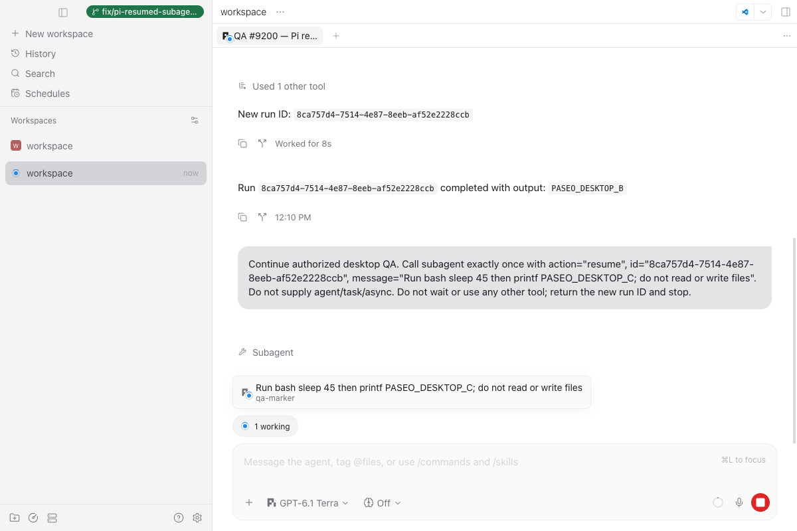
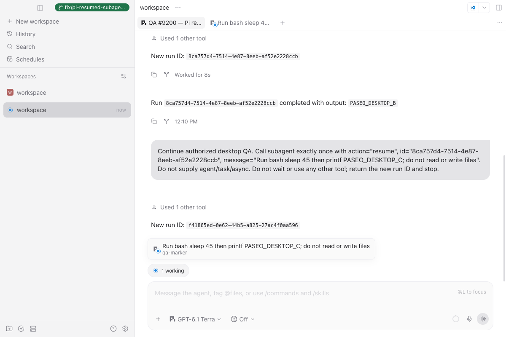
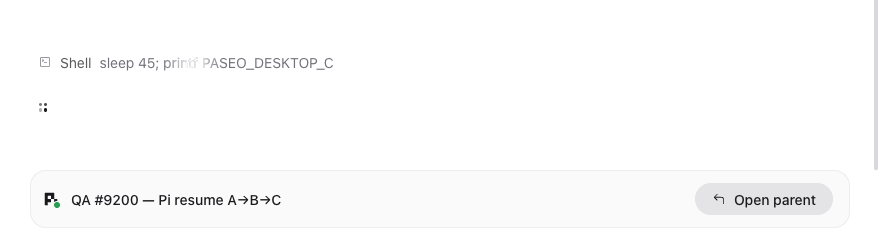
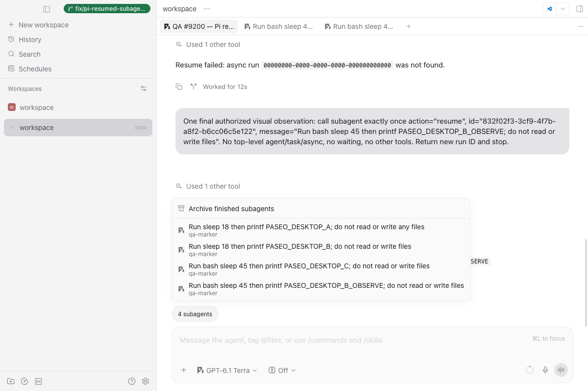

# Pi resumed subagents — #9200

## Scope and provenance

An AI agent ran this QA through Playwright/CDP attached to the **real macOS Electron renderer**, using an isolated desktop-managed daemon. The user authorized the run; this is not a claim that the user personally operated the UI. No production daemon, installed package, or daily host configuration was changed.

Desktop evidence was captured on the modified **0.15.3 development checkout** at base `e260f93cc7b6098f6b175bd0e5c7eb24d3f03cf4`, with Electron 44.2.0, Pi 1.5.0, and installed pi-subagents 0.86.0. The final branch was subsequently fast-forwarded to `d46ee6558c043f9fb377d20f05ff662ce27a31f6` (0.15.4). The adapter and test file stayed byte-for-byte identical. The lockfile changes only workspace version references; third-party dependency entries did not change. Server declarations were rebuilt and the checks below passed on the final base. **These screenshots are not a 0.15.4 release-package test.**

## Before and automated checks

Issue #9200 reports ordinary async spawn appearing in the track while successive successful resumes disappear. The original adapter rejects any `action` and requires top-level `agent`/`task`, which a resume does not supply. A separate file-only transcript deduplication also prevents a new attempt row from following Pi's reused session file.

[Captured command output](validation.txt) contains:

- RED on the original adapter: a successful resume returns no descriptor instead of a running row.
- RED on the intermediate implementation with old file-only deduplication: the next resumed row gets no transcript.
- Final **21/21** tests passing, including consecutive resumes with a real shared temporary JSONL, polling, notice/replay routing, late old-notice isolation, `bg_wait`, failed/management calls, missing launch identity, and the task alias. Existing spawn fixtures still pass.
- Full `npm run format`, `npm run typecheck`, `npm run lint`, and `git diff --check` passing after the base update.

Only the specific adapter test file was run, not the full suite. CI has not been run. There is no old-desktop before screenshot; the reported failure and the two actual RED runs are the before evidence.

## Real desktop steps and observations

1. Built server/app dependencies and launched the existing desktop dev runner with a separate home, Electron userData, Pi configuration/session directory, and async root. The final endpoints were loopback-only: daemon 6768, Metro 8082, and CDP 9223. The renderer's desktop bridge confirmed its own managed daemon/home/server identity. Only the existing pi-subagents extension and a marker-only test agent were enabled; child tasks used `sleep`/`printf`, not workspace edits.
2. Created a Pi parent through the normal Paseo **CLI/API**, asking it to call `subagent({agent:"qa-marker", task, async:true})`. This produced A. The model first enabled the subagent tool, then performed the ordinary spawn. This step was not submitted through the composer.
3. Used the real Electron **composer** to ask Pi for `subagent({action:"resume", id:A, message})`, then resumed B the same way to produce C. No top-level `agent`, `task`, or `async` was supplied to these resume calls. All three finished with their requested markers.
4. Opened the provider-owned track while C ran: it showed `1 working`, the follow-up description, and `qa-marker`. Opening that row showed the reused child conversation and the current Shell call. Each resume had a new run/async directory, while all attempts reused the same session JSONL.
5. While C was still running, clicked **Archive finished subagents**. Completed A/B rows disappeared, while C remained visible as `1 working`.
6. Submitted a nonexistent resume ID through the composer. Pi returned an error and the parent reported “not found”; no new row or async run appeared.
7. The first B screenshot was taken after B finished because screenshot capture waited for fonts. It is not offered as running-state proof. A supplementary real resume from A, B_OBSERVE, was captured as `1 working` and opened successfully. It also finished. The final track contained exactly the four successful runs, not a fifth phantom from the failed resume.

The [selected real tool arguments/results, final statuses, and four completion notices](desktop-observations.json) preserve the test UUIDs. B's `revivedFrom` is A; C's is B. This file contains selected fields from persisted Pi entries/status files, not synthesized launch details. The [dialogue DOM excerpt](dialogue-excerpt.txt) records opening a resumed child. Test-root paths are replaced with `<QA_ROOT>` and the encoded workspace directory with `<QA_WORKSPACE>`; no auth or models configuration is included.

### Screenshots

Unmodified captures, except for the explicitly described dialogue crop. They contain only isolated test prompts, test UUIDs, and app UI; no account, credentials, or user-home paths.

**C running in the native provider-owned track:**

**After archiving finished rows, C remains running:**

**Opened C conversation, current Shell call and parent link:** this is an unaltered crop of the bottom 880×245 pixels of the real child-pane capture, omitting the long temporary session path above it. No state was redrawn.

**Final four completed rows, with the failed resume reported above:**

## Coverage and limits

| Surface                            | Tested                                                                    |
| ---------------------------------- | ------------------------------------------------------------------------- |
| macOS Electron development desktop | Yes — real renderer, composer, track, child pane, archive-finished action |
| Pi RPC / Paseo WebSocket / daemon  | Yes — real provider calls and persisted tool results/notices              |
| Standalone browser web             | No                                                                        |
| iOS / Android                      | No                                                                        |
| Windows / Linux desktop            | No                                                                        |
| Packaged release / CI              | No                                                                        |

Each resumed attempt intentionally gets its own row and reads the whole reused child transcript, including earlier history; it does not slice history by attempt. Old-notice isolation is also covered by the automated regression and the earlier real-notice host replay, rather than forcing a delayed notification in the desktop run.

Short-lived duplicate Shell text was observed in the streaming child pane; its cause was not established and it is not claimed fixed here. The earlier direct-SDK smoke's turn-end persistence error did not recur through this normal RPC run. All four test runners exited, the parent settled idle, and the temporary workspace stayed empty. No claims are made about old workflow issues or daemon-restart global adoption.
