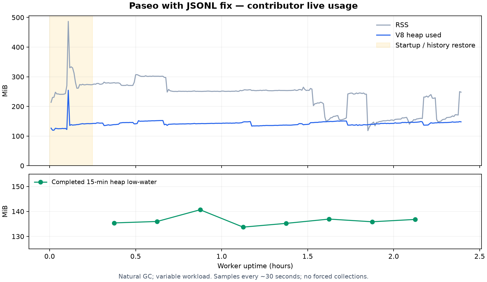

# Contributor usage after installing the JSONL fix

The contributor installed the local arm64 package and used real providers on macOS. This report freezes the first **2 h 23 min** of the new worker's runtime, through **2026-10-22 23:31:23 America/Phoenix (UTC−07)**. Monitoring continued after this cutoff; later samples are not silently added to this dataset.

## Provenance and collection

- Package version: `0.13.0-beta.1`, macOS Apple Silicon / arm64.
- Memory implementation: `4286af24f4a9e6c135e51535d3c41dcf976f5b39` on base `d972f67c3fea06fbc163608f5ddcc2c443de83ac`.
- The local package also contains the separate interruption-recovery change, `4fb6bf80e7773185f7451a217e0baf6618b23809` (PR #7676). These live observations describe the combined package; the synthetic regressions isolate the memory changes.
- Installed `app.asar` SHA256: `42bd04f82f9caa125d2e02f3eb83b7ba4c2b0f95ceb232389c408407352713c7`. It matches the built artifact. The packaged decoder was compared byte-for-byte with the checked compiled implementation.
- The worker executable was verified as the installed app's Helper. PID `51267` started at `2026-10-22 21:07:52−07:00` and stayed unchanged throughout the observation.
- A detached local collector read existing `ws_runtime_metrics` log entries. It made no provider or WebSocket requests and did not attach an inspector, force GC, or restart the daemon. The contributor installed and launched the app; the collector followed the new worker and kept its data separate from the old worker.
- [CSV](live-usage-samples.csv): all 287 samples in the frozen interval, with timestamps and numeric runtime counters only. No conversation text, images, agent IDs, hostnames, credentials, or private paths are exported.
- [Summary JSON](live-usage-summary.json): build identity, coverage, window minima and numeric results. [Plot source](plot-live-usage.py) renders the frozen CSV with matplotlib.

## Observed results

| Metric                                                  | Observation                                                                        |
| ------------------------------------------------------- | ---------------------------------------------------------------------------------- |
| Sampling continuity                                     | 287 samples; maximum interval 30.007 s; no interval over 45 s                      |
| Worker restart                                          | None during the captured interval                                                  |
| Latest heap / RSS                                       | 147.99 / 248.08 MiB                                                                |
| Heap after the first 15 min                             | 133.71–152.47 MiB                                                                  |
| Maximum RSS after the first 15 min                      | 307.14 MiB                                                                         |
| Maximum WebSocket buffered bytes after the first 15 min | 15 bytes                                                                           |
| Final workload                                          | 4 agents, 2 foreground turns, 1,637 resident timeline items, 15 connections        |
| Workload after the first 15 min                         | 3–4 agents, 1–4 foreground turns; resident timeline items grew from 1,247 to 1,637 |

Startup/history restore reached 254.51 MiB heap and 486.67 MiB RSS, then fell. After startup, the sampled heap did not show the earlier 780/1,598 MiB peaks.

Completed 15-minute windows, excluding startup:

| Worker uptime | Minimum sampled heap MiB |
| ------------- | -----------------------: |
| 15–30 min     |                   135.40 |
| 30–45 min     |                   135.97 |
| 45–60 min     |                   140.67 |
| 60–75 min     |                   133.71 |
| 75–90 min     |                   135.22 |
| 90–105 min    |                   136.93 |
| 105–120 min   |                   135.86 |
| 120–135 min   |                   136.79 |

Ordinary least squares on these eight window minima gives **−0.025 MiB/h**, approximately flat. The unfinished 135–143 min window is excluded from this fit.

## Limits

This is passive contributor usage with natural GC and varying workload. Window minima are not forced-GC retained-heap measurements. Thirty-second sampling can miss brief peaks. The exact earlier image-bearing/long-reasoning workload was not replayed on both builds, and two hours does not cover the earlier 6.3-hour failure interval. This record supports stability under the observed load; it does not establish a global heap bound or complete attribution of the earlier production peaks.

Actual adoption and normal provider use are verified. Correct content and replay behavior remain covered by the source regressions; this numeric collection does not independently validate every rendered message. It also does not exercise #7676's interruption-notification recovery path. Official CI and untested-platform coverage are reported separately in the PR.
