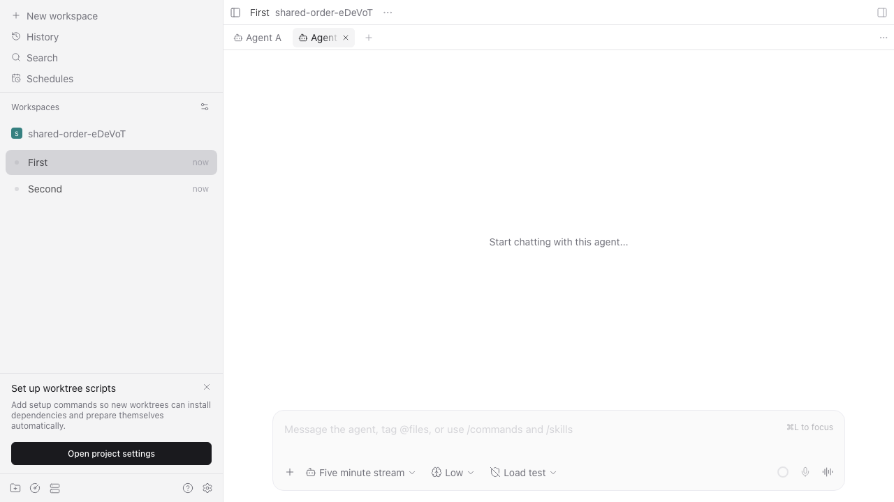
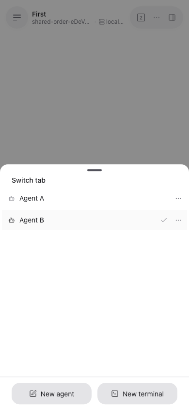
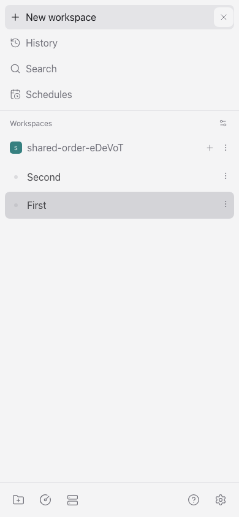
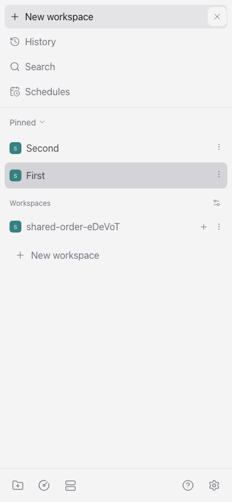

# Shared ordering QA

Run on macOS on 2026-10-13, based on upstream `main` at
`6f62125ee018c5c44e6897c160094594b151036f`.

## Application workflow

The existing sidebar drag regression and the new cross-client flow ran against an
isolated real daemon. Agents were seeded with the existing `mock` provider; no
provider execution was required for sorting. Port 6767 was blocked in both browser
contexts.

The second Chromium context had a 390 × 844 viewport and received only connection
settings. Its order cache, workspace layout, client identity, and replica database
were independent of the first context.

1. Drag a desktop workspace row and observe the same order in the compact sidebar.
2. Drag back from the compact sidebar and observe the desktop order change.
3. Drag an agent tab on desktop and observe the same relative order in the compact
   tab switcher. Each device retains its own focus and open tabs.
4. Reload the compact client. Its workspace and tab order still match the daemon.
5. Pin both workspaces, drag their desktop rows, and observe the matching compact
   Pinned order.

Command, from `packages/app`:

```sh
E2E_RECORD_VIDEO=1 npx playwright test --project=browser sidebar-reorder.spec.ts
```

Observed output:

```text
✓ projects, workspaces, and pinned chats reorder with an immediate mouse drag (20.9s)
✓ workspace and tab reorder propagate to an independent compact client and survive reload (51.4s)
2 passed (2.7m)
```

[Desktop recording](desktop-recording.webm)

| Desktop tab order                                  | Compact Web tab order                                  |
| -------------------------------------------------- | ------------------------------------------------------ |
|  |  |

| Compact Web workspace order                                        | Compact Web Pinned order                                     |
| ------------------------------------------------------------------ | ------------------------------------------------------------ |
|  |  |

## Focused automated checks

From `packages/app`:

```sh
npx vitest run src/ordering/index.test.ts src/ordering/replica.test.ts src/ordering/layout.test.ts src/stores/sidebar-order-store.test.ts src/stores/workspace-layout-store.test.ts src/i18n/resources.test.ts --bail=1
```

```text
Test Files  6 passed (6)
     Tests  188 passed (188)
```

From `packages/server`:

```sh
npx vitest run src/server/ordering/index.test.ts src/server/ordering/index.e2e.test.ts --bail=1
```

```text
Test Files  2 passed (2)
     Tests  6 passed (6)
```

The real daemon checks cover two active clients, an idle client receiving no order
traffic, stale revision rejection, a fresh connection reading authority, released
subscriptions, scope validation, unpinning, archive, and project removal. Storage
unit tests cover restart persistence and failed disk writes without publication.
Client tests cover cold caches, host capability gating, queued gestures, newer
broadcasts racing older replies, disposal, and preserving splits and focus.

From `packages/protocol`:

```sh
npx vitest run src/ordering.test.ts --bail=1
```

```text
Test Files  1 passed (1)
     Tests  3 passed (3)
```

From the repository root:

```sh
npm run build:server
npm run typecheck
npm run lint
npm run format:check
```

All exited with status 0. Lint reported `Found 0 warnings and 0 errors`.
Formatting reported `All matched files use the correct format`.

## Coverage boundary

| Surface                                     | Exercised                                                                           |
| ------------------------------------------- | ----------------------------------------------------------------------------------- |
| macOS daemon and client WebSocket API       | Real isolated daemon with independent clients                                       |
| Chromium desktop layout on macOS            | Actual drag, screenshots, and recording                                             |
| Chromium compact layout on macOS            | Independent context, reverse workspace drag, tab switcher, reload, and Pinned order |
| Native iOS / Android                        | Not exercised                                                                       |
| Packaged Electron Desktop / Windows / Linux | Not exercised                                                                       |

The compact screenshots are Web evidence, not native mobile acceptance. The first
explicit drag establishes a shared scope. This change synchronizes relative order
within a pane; it does not synchronize open/closed tabs, pane membership, or focus.
Cross-daemon interleaving and project-header ordering remain device-local.
