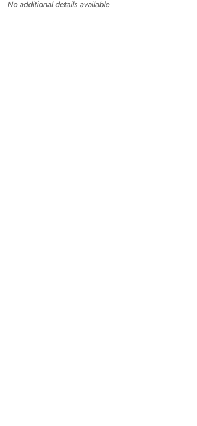

# Tool-call details empty state — #9128

## Scope and provenance

An agent captured these screenshots from the actual `ToolCallDetailsContent` component in the Chromium browser test project. The before image was captured before adding the inset; the after image was captured after the fix. Both use the app's real translation for the empty message. The isolated capture does not render the sheet header; the regression test checks that the message has the same 16px horizontal inset as that header.

## Before and after

**Before:**

**After:**

## Verification

[Raw test and check output](validation.txt) records the regression test failing before the fix and passing after it, plus the repository typecheck, lint, and format checks.

## Coverage and limits

| Surface                           | Tested                                                  |
| --------------------------------- | ------------------------------------------------------- |
| Chromium browser component render | Yes                                                     |
| Android SM-F741N (API 37)         | Development build is still running; UI not verified yet |
| iOS and desktop                   | No                                                      |

The test checks the rendered message and both horizontal padding values. It does not claim end-to-end coverage of the tool-call sheet flow.
