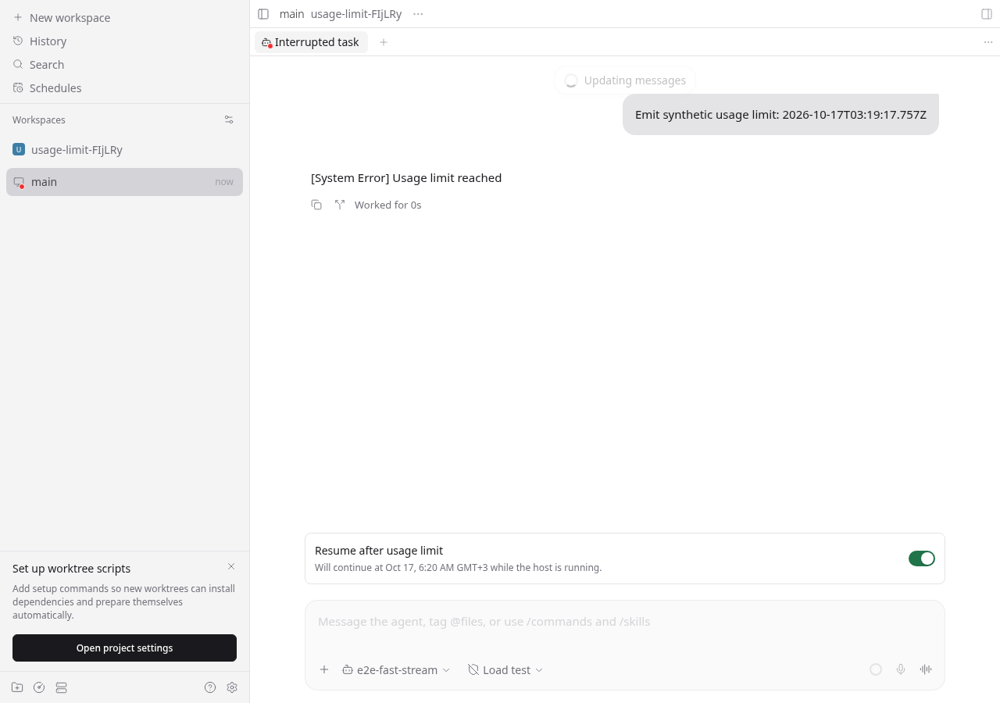
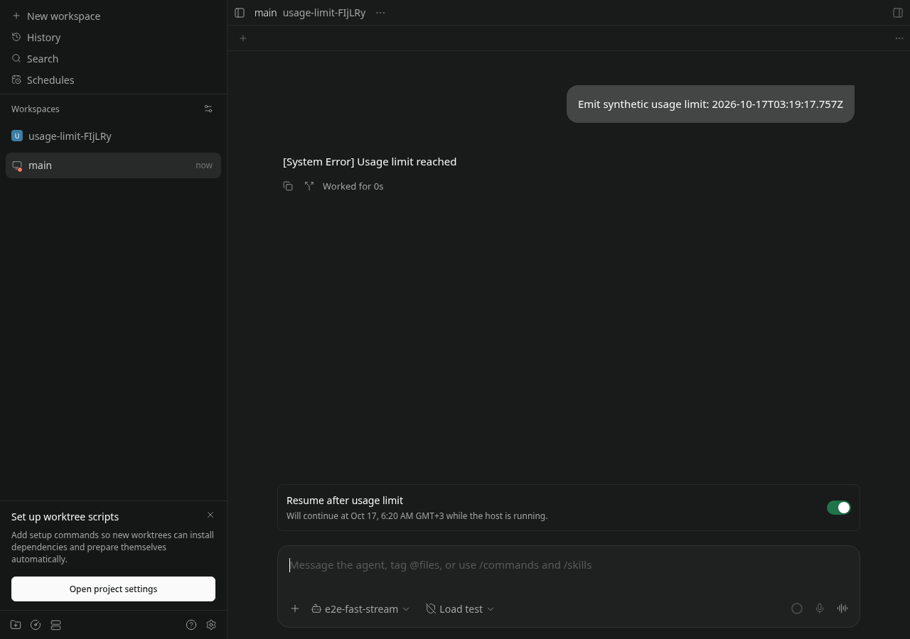
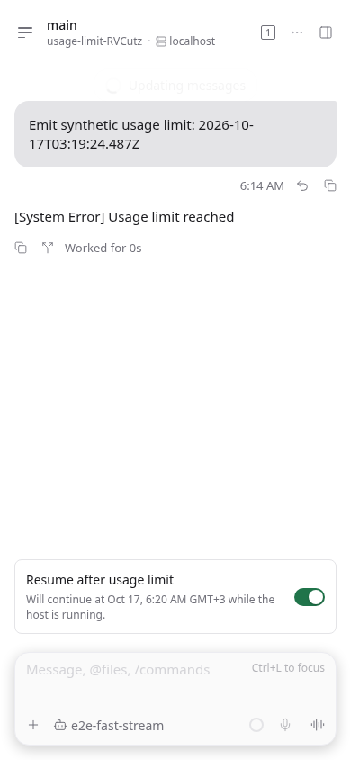
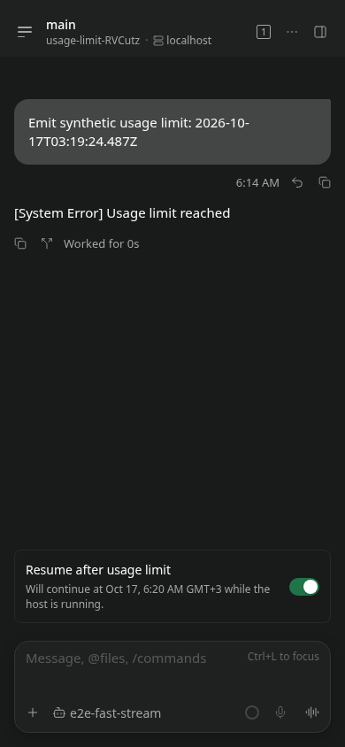

# Usage limit resume QA

Tested on 2026-10-17 against main `88a7aec1b`, in an ordinary isolated worktree. The installed Paseo daemon and user sessions were not restarted or modified. Node 26.11.1, npm 12.2.0, Claude Code 2.1.286, Linux, Playwright Chromium.

## Real Claude detection

A signed-in Claude account was already at its actual five-hour subscription cap. Ran:

```sh
claude -p 'Reply with OK only. Do not use tools.' --output-format stream-json --verbose --max-turns 1
```

The CLI emitted a `rate_limit_event` with `status: "rejected"`, `rateLimitType: "five_hour"`, `resetsAt: 1792219200`, and `isUsingOverage: false`. Its final result had `subtype: "success"` **and** `is_error: true`, with the same message as the reported screenshot. The adapter regression tests cover this combination.

Also invoked the real `ClaudeAgentClient.createSession` / `session.startTurn` API against that account in a fresh temporary directory, subscribed to its terminal event, asserted `turn_failed` and a future structured reset time, then closed the session and removed the directory. [The selected event output](real-claude.json) contains the actual result; account configuration and full CLI transcripts are excluded.

Observed: `You've hit your session limit · resets 9:40am (Europe/Moscow)` became `usageLimit.resetsAt: "2026-10-17T06:40:00.000Z"`.

The real multi-hour reset has **not** been waited out. Detection above used real Claude; deadline dispatch and browser flows below used the existing mock provider's explicitly synthetic failure mode.

## Browser interaction

```sh
E2E_RECORD_VIDEO=1 npm exec --workspace=@getpaseo/app -- playwright test e2e/browser/usage-limit-resume.spec.ts --project=browser --workers=1
```

[Raw output: 4 passed](browser-tests.txt). Real app, isolated real daemon, real WebSocket messages and file persistence; synthetic provider limit.

- At 1280×900 and 390×844: send a synthetic future limit; switch initially off; enable; reload; verify it remains on; disable; send a manual continuation; verify the callout disappears. Capture both themes.
- Send an overdue synthetic limit; enable; wait for the daemon scan; verify exactly one continuation prompt in the same chat and that the preference remains enabled. Disable to hide the inactive callout.
- Send a synthetic limit with no reset time; verify the explanation and disabled opt-in; continue manually.

Recordings: [wide interaction](wide.webm), [compact interaction](compact.webm), [automatic continuation](automatic-continuation.webm).

| Light                                       | Dark                                            |
| ------------------------------------------- | ----------------------------------------------- |
|        |        |
|  |  |

## Automated checks

```sh
npm run build:server
npm run build:app-deps
npm run typecheck
npm run lint
npm run format
npm exec -- vitest run packages/server/src/server/agent/usage-limit-resume.test.ts packages/server/src/server/agent/agent-manager.test.ts packages/server/src/server/agent/agent-archive.test.ts packages/server/src/server/agent/providers/claude/agent.redesign.test.ts packages/protocol/src/messages.test.ts packages/app/src/i18n/resources.test.ts
```

Raw outputs: [server build](build.txt), [app dependency build](app-deps-build.txt), [typecheck](typecheck.txt), [lint](lint.txt), [format](format.txt), [337 targeted tests](tests.txt). No full test suite was run.

Coverage includes same provider session, durable restart recovery, concurrent scans, default-off behavior, reset buffer, unknown reset, manual cancellation (including a manual turn completing during a paused durable claim), disabled/archived/blocked-workspace/shutdown guards, advisory/overage events, invalid reset metadata, old-shaped protocol messages, and translation parity.

## Platform coverage

| Platform        | Tested | Notes                                                                                |
| --------------- | ------ | ------------------------------------------------------------------------------------ |
| Web             | Yes    | Chromium, wide and compact, light and dark; videos above                             |
| Linux daemon    | Yes    | Real Claude detection; synthetic deadline and restart tests                          |
| iOS             | No     | No simulator/device available                                                        |
| Android         | No     | No emulator/device available                                                         |
| Desktop macOS   | No     | No host available                                                                    |
| Desktop Windows | No     | No host available                                                                    |
| Desktop Linux   | No     | Electron binary/display unavailable; browser coverage does not prove native behavior |

Only Claude currently supplies usage-limit metadata to this feature. Other provider adapters were not verified against live caps. No provider quota API is polled and no reset time is inferred from localized prose.
