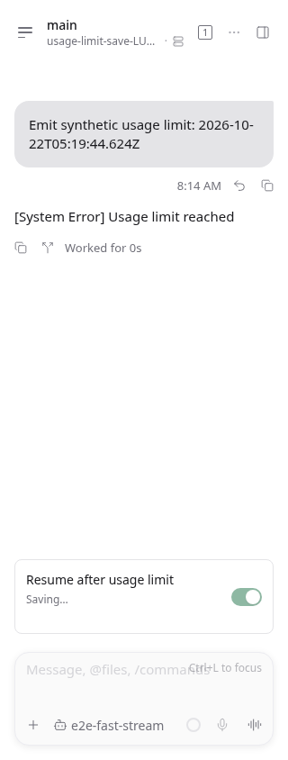
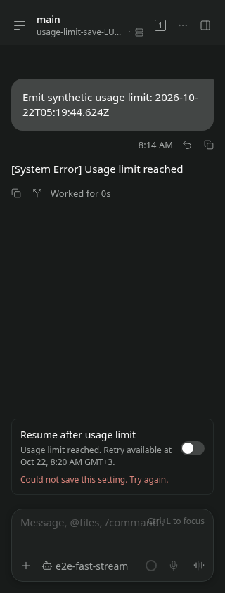
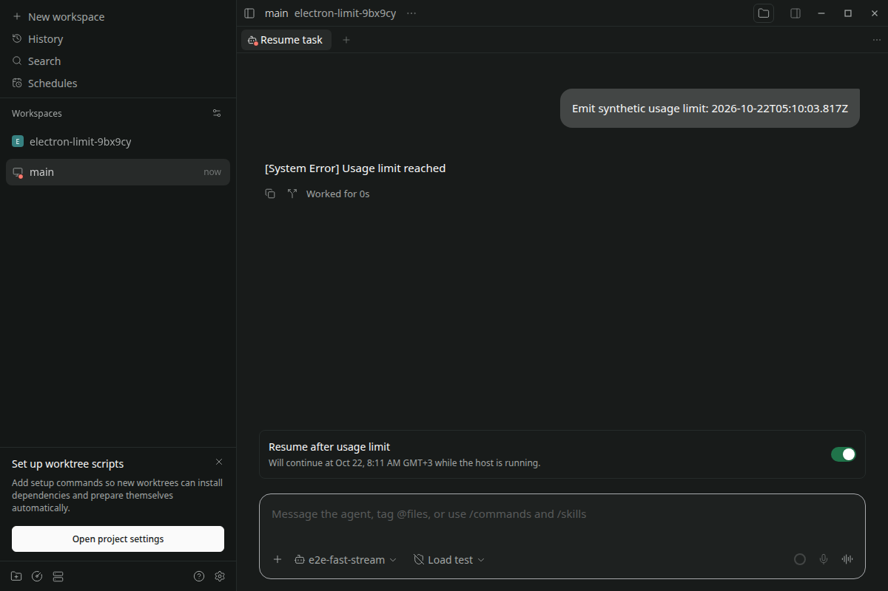

# Usage limit resume QA

Updated on 2026-10-22 after merging main `bdae614e95d7501f685cef2e65d1da864978d363`. The real Claude detection evidence below was captured on 2026-10-17 against main `88a7aec1b`. All follow-up runs use isolated worktrees. The installed Paseo daemon and user sessions were not restarted or modified. Node 26.11.1, npm 12.2.0, Claude Code 2.1.286, Linux, Playwright Chromium.

## Real Claude detection

A signed-in Claude account was already at its actual five-hour subscription cap. Ran:

```sh
claude -p 'Reply with OK only. Do not use tools.' --output-format stream-json --verbose --max-turns 1
```

The CLI emitted a `rate_limit_event` with `status: "rejected"`, `rateLimitType: "five_hour"`, `resetsAt: 1792219200`, and `isUsingOverage: false`. Its final result had `subtype: "success"` **and** `is_error: true`, with the same message as the reported screenshot. The adapter regression tests cover this combination.

Also invoked the real `ClaudeAgentClient.createSession` / `session.startTurn` API against that account in a fresh temporary directory, subscribed to its terminal event, asserted `turn_failed` and a future structured reset time, then closed the session and removed the directory. [The selected event output](real-claude.json) contains the actual result; account configuration and full CLI transcripts are excluded.

Observed: `You've hit your session limit · resets 9:40am (Europe/Moscow)` became `usageLimit.resetsAt: "2026-10-17T06:40:00.000Z"`.

The real multi-hour reset has **not** been waited out. Detection above used real Claude; deadline dispatch and browser flows below used the existing mock provider's explicitly synthetic failure mode.

## Browser interaction

```sh
E2E_RECORD_VIDEO=1 npm exec --workspace=@getpaseo/app -- playwright test e2e/browser/usage-limit-resume.spec.ts --project=browser --workers=1
```

[Raw output: 5 passed](browser-tests.txt). Real app, isolated real daemon, real WebSocket messages and file persistence; synthetic provider limit.

- At 1280×900 and 390×844: send a synthetic future limit; switch initially off; enable; reload; verify it remains on; disable; send a manual continuation; verify the callout disappears. Capture both themes.
- Send an overdue synthetic limit; enable; wait for the daemon scan; verify exactly one continuation prompt in the same chat and that the preference remains enabled. Disable to hide the inactive callout.
- Send a synthetic limit with no reset time; verify the explanation and disabled opt-in; continue manually.
- At 320 px, hold a real preference RPC at the WebSocket boundary: verify pending feedback and disabled switch, reject the save, verify the off state and localized error, then retry successfully. The UI displays translated guidance instead of raw RPC metadata.

Recordings: [wide interaction](wide.webm), [compact interaction](compact.webm), [automatic continuation](automatic-continuation.webm), [save failure and retry](save-error-retry.webm).

| Light                                       | Dark                                            |
| ------------------------------------------- | ----------------------------------------------- |
|        |        |
|  |  |

## Review regression verification

Added controlled storage/provider boundary adapters to reproduce cancellation during a durable claim and during cold session loading, plus a failed snapshot write. On the previously published `dabfb1b9f3` implementation, [the same regression tests failed in all three cases](review-before-fix.txt): both cancellation paths dispatched an unwanted prompt, and the failed write lost the live wait. These adapters are injected dependencies backed by the real temporary file store and mock-provider session; no module-export spies are used.

Cancellation now marks the active attempt immediately before entering the serialized lifecycle queue. A failed durable claim restores the live wait only if no manual message, active run, or newer limit superseded it. Separate regression cases cover manual input and a newer limit during a failed write, and archiving during cold recovery. Tests use fixed scenarios without conditional assertions. Browser tests select the switch by its accessible role/name and keep interaction mechanics in shared helpers.

```sh
npm exec -- vitest run packages/server/src/server/agent/usage-limit-resume.test.ts packages/server/src/server/agent/agent-manager.test.ts packages/server/src/server/agent/providers/mock-load-test-agent.test.ts
```

[239 tests passed across these three files](review-regression.txt), including 17 usage-limit service/lifecycle tests. The five browser cases above were rerun on 2026-10-22; their current output, screenshots and recordings are from that follow-up. [97 targeted tests](targeted-tests.txt) cover usage-limit recovery, Claude adapter behavior and protocol compatibility; [55 i18n tests](i18n-tests.txt) cover resources/locales. Typecheck, lint, format and build logs were refreshed.

## Initial automated checks

```sh
npm run build:server
npm run build:app-deps
npm run typecheck
npm run lint
npm run format
npm exec -- vitest run packages/server/src/server/agent/usage-limit-resume.test.ts packages/server/src/server/agent/agent-manager.test.ts packages/server/src/server/agent/agent-archive.test.ts packages/server/src/server/agent/providers/claude/agent.redesign.test.ts packages/protocol/src/messages.test.ts packages/app/src/i18n/resources.test.ts
```

Initial verification (before the review fixes): [server build](build.txt), [app dependency build](app-deps-build.txt), [338 targeted tests](tests.txt). Current follow-up outputs: [typecheck](typecheck.txt), [lint](lint.txt), [format](format.txt). No full test suite was run.

Coverage includes same provider session, durable restart recovery, concurrent scans, default-off behavior, reset buffer, unknown reset, manual cancellation (including a manual turn completing during a paused durable claim), disabled/archived/blocked-workspace/shutdown guards, advisory/overage events, isolation of consecutive autonomous turns, invalid reset metadata, old-shaped protocol messages, and translation parity.

## Platform coverage

| Target                   | Evidence and limits                                                                                                                                                                                             |
| ------------------------ | --------------------------------------------------------------------------------------------------------------------------------------------------------------------------------------------------------------- |
| Web                      | Chromium, 1280 px, 390 px and saving/error/retry at 320 px; light/dark screenshots and recordings above.                                                                                                        |
| Linux daemon             | Real Claude limit detection from October 17; synthetic deadline, cancellation, durable recovery and exactly-once browser checks.                                                                                |
| Linux Electron           | [Real desktop application passes](electron-tests.txt): opt-in, reload persistence, light/dark presentation and automatic continuation once. Compiled main/preload, asserted preload bridge and isolated daemon. |
| iOS / Android            | [Both Expo/Hermes exports pass](native-export.txt). Shared native callout and switch inspected; no native app/device, simulator, touch or screen-reader runtime test.                                           |
| macOS / Windows Electron | Shared renderer inspected; no host runtime available.                                                                                                                                                           |

The callout uses shared theme/font tokens, wrapping text, the existing accessible switch, localized reset time and all nine translation resources. Saving preserves layout, disables repeated changes, and failures allow retry.





The temporary Electron launch source is retained as [spec](feature-electron.qa.spec.ts.txt) and [config](feature-electron.config.ts.txt). It reuses the regular app fixtures, launches the actual desktop package with a temporary profile/daemon home on Xvfb `:193`, and closes them afterward. The executable path records this Linux host. Command: `E2E_DESKTOP_RUNTIME=1 npm exec -- playwright test --config=.dev/feature-electron.config.ts`. [Desktop main build output](desktop-build.txt).

Only Claude currently supplies usage-limit metadata to this feature. Other provider adapters were not verified against live caps. No provider quota API is polled and no reset time is inferred from localized prose. The real multi-hour reset was not waited out; automatic continuation tests use explicit synthetic limits.
