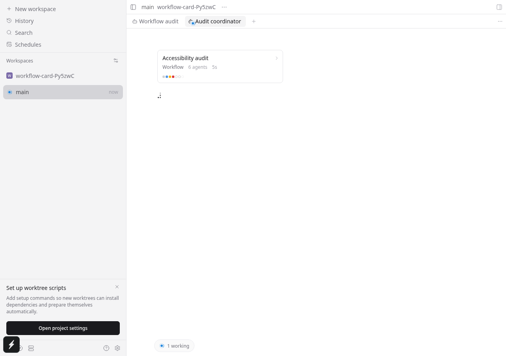
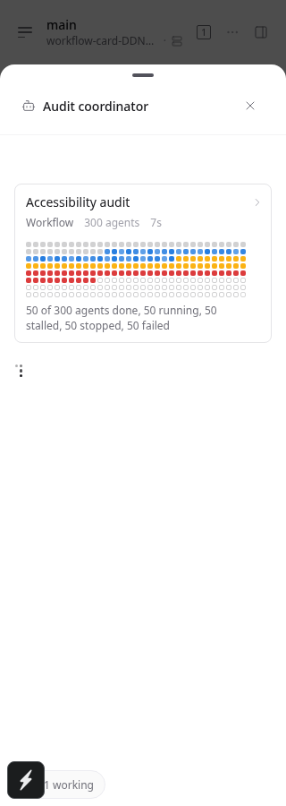
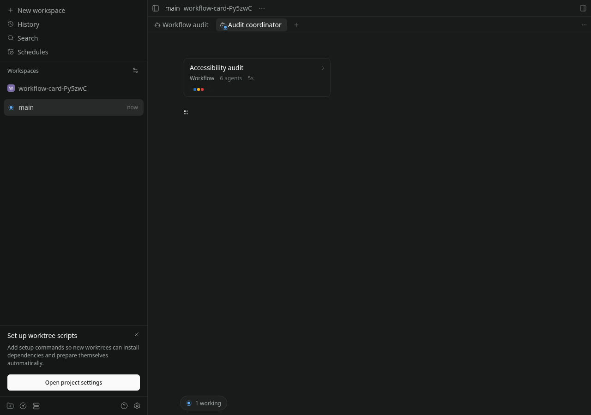
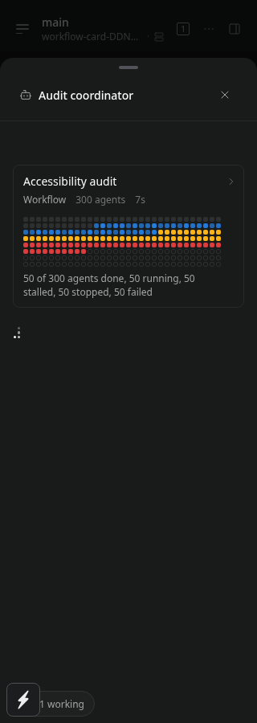
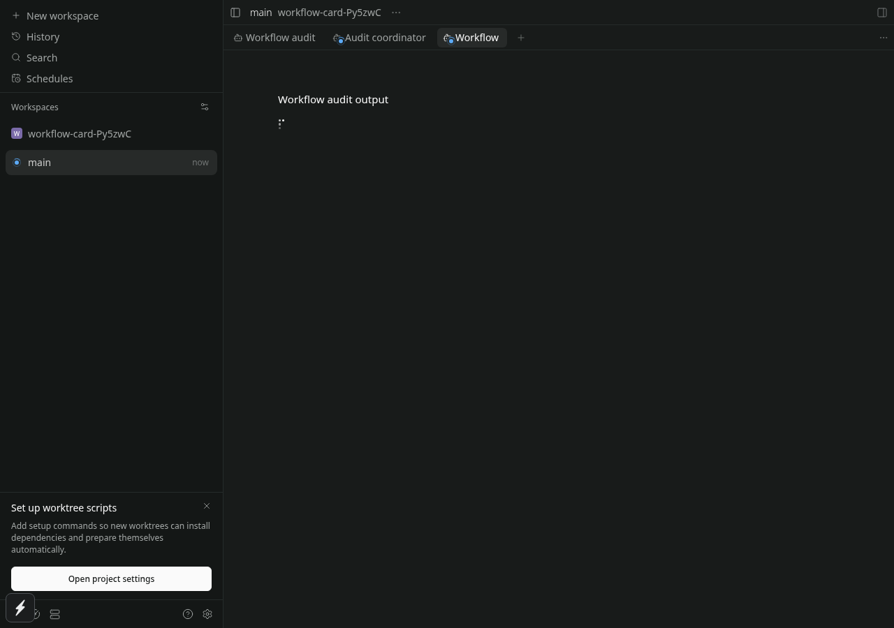
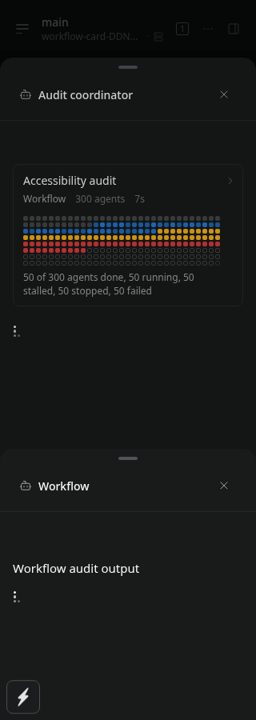
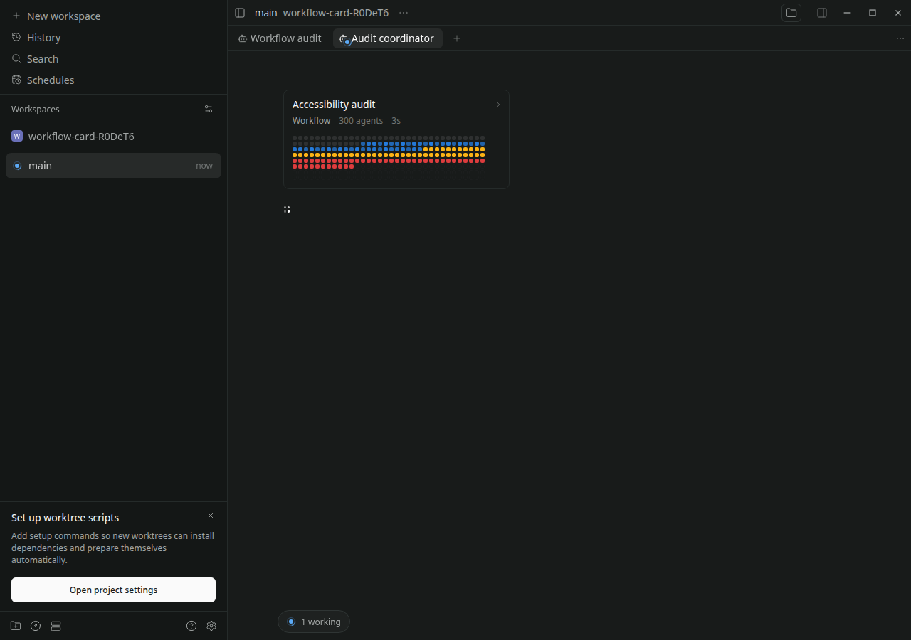

# Workflow swarm QA

Verified on 2026-10-22 after merging main `bdae614e95d7501f685cef2e65d1da864978d363`. All interaction tests use the real app and an isolated real daemon. The mock provider emits explicitly synthetic workflow events at the provider boundary. The installed daemon and user sessions were untouched.

## Nested workflow regression

Before the parent-ID fix, [the wide nested workflow case fails](nested-before-fix.txt): the nested tool call cannot find its workflow descriptor. The synthetic stream ID was incorrectly used as the managed agent ID. The panel now passes the managed owner separately, so descriptor lookup and navigation both target the same owning agent.

[Four browser cases pass](browser-tests.txt): root workflows at 1280 and 320 px, nested workflows at 1280 and 320 px. The compact nested and both root cases contain 300 agents. Assertions cover the full accessible progress summary, all grid cells fitting their bounds, and opening the workflow's own timeline. Each scenario captures light and dark themes.

```sh
E2E_RECORD_VIDEO=1 npm exec --workspace=@getpaseo/app -- playwright test e2e/browser/agent-stream-ui.spec.ts --project=browser --grep 'workflow shows progress' --workers=1 --max-failures=1
```

[Wide recording](nested-wide.webm), [compact recording](nested-compact.webm).

| Wide                                   | Compact 320 px                               |
| -------------------------------------- | -------------------------------------------- |
|    |    |
|      |      |
|  |  |

## Platform and design coverage

| Target                   | Evidence and limits                                                                                                                                                                                                                                                     |
| ------------------------ | ----------------------------------------------------------------------------------------------------------------------------------------------------------------------------------------------------------------------------------------------------------------------- |
| Web                      | Chromium: four cases above, wide/compact, light/dark, nested navigation and 300-cell grid.                                                                                                                                                                              |
| Linux Electron           | [Real desktop application passes](electron-tests.txt), with compiled Electron main/preload and an isolated daemon. Preload bridge asserted; nested 300-agent card and navigation exercised in both themes.                                                              |
| iOS / Android            | [Expo exports both Hermes bundles](native-export.txt). Shared native card uses press feedback, wrapping metadata, theme font metrics and a visible state summary; no hover dependency. No native app, device, simulator, touch, or screen-reader runtime was exercised. |
| macOS / Windows Electron | Shared renderer/design inspected; no host runtime available for a platform-specific run.                                                                                                                                                                                |

Desktop hover labels and reduced-motion-aware web pulse remain available. Native dots are deliberately static; native and compact layouts also show the translated progress counts below the grid. The card's accessible hint contains those counts. All nine translation resources include running, stalled, stopped and failed counts, including mixed canceled workflows.



The temporary Electron QA launch source is retained as [spec](feature-electron.qa.spec.ts.txt) and [config](feature-electron.config.ts.txt). It reuses the regular app fixtures and workflow helper, launches the actual desktop package with a temporary profile and daemon home on Xvfb `:193`, and closes them afterward. Its executable path records this Linux host, not a portable runner. Command: `E2E_DESKTOP_RUNTIME=1 npm exec -- playwright test --config=.dev/feature-electron.config.ts`.

## Targeted checks

[88 tests](targeted-tests.txt) cover the mock provider, Claude background subagents, live workflow source and workflow throttling. [55 i18n tests](i18n-tests.txt) cover resource parity/locales. [Server build](build.txt), [app dependencies](app-deps-build.txt), [desktop main build](desktop-build.txt), [typecheck](typecheck.txt), [lint](lint.txt), and [format](format.txt) pass. No full test suite was run.

These checks do not constitute a fresh live Claude workflow run. The UI data above is synthetic; the targeted Claude parser/provider tests exercise the real implementation.
